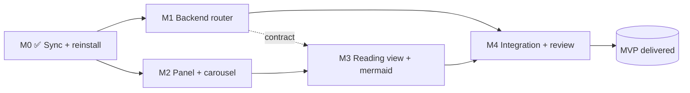

# Course Explorer — Delivery Milestones (Phases 1–3 MVP)

**Companion to:** `VIABILITY.md`, `PLAN.md`. Produced by a 3-agent decomposition fan-out (backend / frontend / test specs), then reconciled.
**Scope of this delivery:** Phase 0 (done) → Phase 1 → Phase 2 → Phase 3. A working read-only course browser: browse providers/courses in carousels → open a lesson → read rendered markdown + mermaid. Search (P4), struggle-marking (P5), TTS (P6) are explicitly out of scope here.

---

## ⚠️ Canonical API contract (single source of truth)

The three decomposition agents proposed **divergent** endpoint shapes. This section is authoritative — both backend and frontend build to THIS. Any agent spec that disagrees is overridden here.

### `GET /api/explorer/tree`
Nested Provider→Course tree. No query params. Cached on `app.state` (mtime of base + 30s TTL fallback). Returns `[]` when `content.base_path` is missing/empty (never 404/500).
```json
[
  { "id": "CodeWithMosh", "name": "Code With Mosh",
    "courses": [
      { "id": "CodeWithMosh/Complete_SQL_Mastery", "name": "Complete Sql Mastery", "provider": "CodeWithMosh" }
    ] }
]
```
- `id` (provider) = raw dir name; `name` = humanised. `courses[].id` = `"{provider}/{course}"` (the `course_id`).
- Skips dot-dirs and output dirs (`flashcards`, `quizzes`). Two-level layout only (`base/provider/course`).

### `GET /api/explorer/courses/{course_id:path}/lessons`
`course_id` = `"provider/course"` (contains a slash → `:path` converter required).
```json
[
  { "id": "CodeWithMosh/Complete_SQL_Mastery/study-notes/ch1",
    "slug": "study-notes/ch1", "name": "Ch1",
    "course_id": "CodeWithMosh/Complete_SQL_Mastery" }
]
```
- `id` = `"{course_id}/{slug}"` (the `lesson_id`). `slug` = path rel to course dir, suffix stripped.
- 404 (`{"detail":"Course not found: ..."}`) when dir missing; traversal-escape → 404.

### `GET /api/explorer/lesson/{lesson_id:path}/content`
`lesson_id` = `"provider/course/relpath"` (no suffix; multiple slashes → `:path`).
```json
{ "content": "# Chapter 1\n\n...", "lesson_id": "CodeWithMosh/Complete_SQL_Mastery/study-notes/ch1" }
```
- **JSON, not raw text** (consistent with the rest of the API; frontend renders client-side).
- Path-traversal guarded (`.resolve()` + `is_relative_to(base.resolve())`, reject `..` parts pre-resolve) **and** suffix allowlist `{.md,.markdown,.txt}`. Any violation or missing file → **404, no detail**.

### Frontend URL construction (avoids the encodeURIComponent-eats-slashes trap)
`lesson.id` already carries the full slash-joined id from the `/lessons` response. Build the URL by encoding **each segment** and re-joining with `/` so `:path` still sees real slashes:
```js
const enc = id => id.split('/').map(encodeURIComponent).join('/');
fetch(`/api/explorer/lesson/${enc(lesson.id)}/content`)
```

---

## Milestone map



- **M1 (backend) ∥ M2 (frontend-panel)** — disjoint file sets (Python routes vs index.html/components.js/style.css), genuinely parallel.
- **M3 (reading view)** edits the *same frontend files* as M2 → must follow M2 (serialized).
- **M4** = un-stubbed end-to-end integration + adversarial review fan-out.

---

## M0 — Sync + reinstall ✅ DONE
Rebased onto `feat/settings-providers-panel` (render libs now tracked); reinstalled editable; smoke-booted (`/`=200, `/api/courses` returns publisher field, 8 providers listed). Docs preserved at `8ceb736`.

---

## M1 — Backend explorer router
**Files:** `web/routes/explorer.py` (new), `web/app.py` (register + 2 `app.state` lines), `tests/test_web_explorer.py` (new).
**Build:** the 3 endpoints above. Copy the traversal guard pattern from `artefacts.py:_validate_artefact_path`. Reuse the `rglob`+skip-output-dirs loop from `courses.py:list_course_sections`. `load_settings()` called per-request (test monkeypatch-friendly).
**Acceptance (DONE checklist):**
- [ ] All 3 endpoints return the canonical shapes above.
- [ ] `tree` returns `[]` for missing base; skips dot/output dirs; cached on `app.state`.
- [ ] Traversal: `..`, `%2e%2e`, absolute path, symlink-escape → 404/422. Suffix `.json`/`.png` → 404.
- [ ] `uv run pytest packages/studyloop/tests/test_web_explorer.py -v` → all green (~30+ tests incl. traversal class).
- [ ] No regression: `test_web_app.py`, `test_web_courses_sections.py`, `test_web_content_providers.py` still pass.

## M2 — Explorer panel + carousel
**Files:** `style.css` (grid → `200px 1fr 320px`; mobile hide; new scoped `.course-explorer-panel*` block), `index.html` (insert `<aside>` between `.sidebar` and `.content-area`; add `'course-reader'` to nav `valid`), `components.js` (`courseExplorer()` factory).
**Build:** lazy-fetch `/api/explorer/tree` on init; one carousel row per provider (CSS scroll-snap + prev/next `scrollBy`); per-provider filter; ARIA roles; **scoped header reset** to avoid the `header{display:flex}` cascade ([[css-cascade-nested-header]]).
**Acceptance:**
- [ ] Panel renders a row per provider with course cards from the live vault.
- [ ] Carousel scroll-snaps; prev/next buttons work; cards don't overlap (**geometry assertion**, not visibility).
- [ ] Panel header stacks (no flex-row overlap). Mobile (≤600px) hides panel / keeps carousel within viewport.
- [ ] New geometry tests in `test_web_layout_regression.py::TestCourseExplorerLayout`; **proven able to fail** by reverting a CSS rule.

## M3 — Reading view + mermaid
**Files:** `components.js` (extract `renderMarkdown`+`_escapeHtml` to top-level util; add reading state to `courseExplorer()` or a `courseReaderPanel()`), `index.html` (reading-view block + mermaid `<script>`), `style.css` (`.explorer-reader-prose`, `.mermaid-diagram`), `vendor/js/mermaid-11.*.min.*` (new).
**Build:** extract the existing `_renderMarkdown` (currently trapped in `liveAgentConsole()`) to a shared global; original caller delegates to it. Vendor mermaid v11; `initialize({startOnLoad:false})`; two-pass render (markdown→sanitize→inject→hljs→`await mermaid.render` on `.mermaid` blocks, after `$nextTick`). Render into `.acp-message-final` prose CSS. `mdToPlainText` NOT needed (that's P6/TTS).
**Acceptance:**
- [ ] Selecting a lesson fetches `/content` and renders formatted prose — no raw `#`/`**` visible.
- [ ] Code blocks get `hljs` highlighting; a ```mermaid fence renders an `<svg>` (no raw `graph TD` text).
- [ ] Reading body scroll-reachable inside its container; within viewport at mobile.
- [ ] `test_web_reading_view_e2e.py` + `TestLessonReadingViewLayout` geometry tests green.

## M4 — Integration + adversarial review
**Build:** reinstall editable; **un-stubbed** end-to-end check against the real vault (open panel → real provider/course → real lesson → rendered md+mermaid). Fan-out review: security/traversal, correctness, UI-layout. Full suite + lint.
**Acceptance:**
- [ ] `uv run ruff check/format --check` clean; `uv run pytest packages/studyloop/tests/ -v` reports pass/fail count, all green.
- [ ] E2e suite (incl. settings-panel regression guard) green after reinstall.
- [ ] Manual demo click-path verified against the real Obsidian vault.
- [ ] Review fan-out returns GO with no unresolved 🔴.

---

## Test commands (user prefs: `uv run` prefix, report pass/fail)
```bash
uv run ruff check packages/studyloop/src packages/studyloop/tests
uv run ruff format --check packages/studyloop/src packages/studyloop/tests
uv run pytest packages/studyloop/tests/ -v                       # default (excludes e2e)
uv tool install --reinstall './packages/studyloop[web,content,bedrock]' # before e2e (stale-asset guard)
uv run pytest packages/studyloop/tests/ -m e2e -v                # browser suite
```
