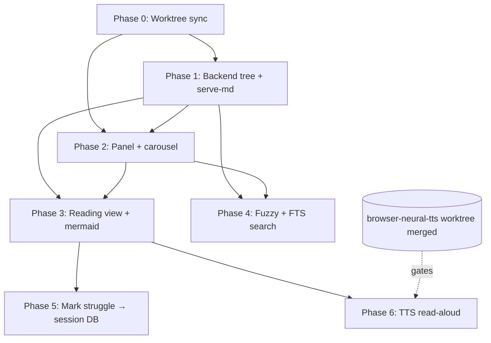

# Course Explorer Side Panel — Phased Implementation Plan

**Companion to:** `VIABILITY.md` (verdict: GO, high confidence)
**Worktree:** `.claude/worktrees/course-explorer-panel`
**All `file:line` refs target the `feat/settings-providers-panel` branch** (the current main working checkout), not this worktree's HEAD — see VIABILITY.md "Scope & accuracy caveat".

---

## Phase 0 — Worktree sync & baseline (prerequisite)

The worktree branched from `origin/main` and is missing the vendored render libs + TTS work.

1. Rebase or merge this worktree onto the branch that holds the current web UI + vendored `marked`/`DOMPurify`/`highlight.js` (`feat/settings-providers-panel`, or `main` once that branch merges).
2. Reinstall the tool so static assets aren't stale: `uv tool install --force --editable packages/studyloop` (per [[stale-install-masks-fixes]]).
3. Smoke-run `studyloop web` and confirm the existing UI loads, `/api/courses` responds, and `~/.config/studyloop/config.yaml` has `content.base_path: ~/Obsidian/Personal/Study`.

**Exit criteria:** app boots from this worktree; vendored `marked@12`, `purify@3.1`, `highlight@11.9` present under `web/static/vendor/js/`.

---

## Phase 1 — Backend: course tree + serve-markdown (read-only)

**Goal:** API can list the Provider→Course→Lesson tree and serve a single lesson's raw markdown, safely.

New router `web/routes/explorer.py`, registered at `app.py:83` alongside the others.

1. **`GET /api/explorer/tree`** — returns nested `{providers:[{id,name,slug,courses:[{id,provider_id,title,lesson_count}]}]}`.
   - Reuse `content_gen.list_content_publishers()` + `list_content_courses()` logic (reads `content.base_path`).
   - **Cache** the result in `app.state` with a TTL or mtime check (R6) — do not `rglob` per request.
2. **`GET /api/explorer/courses/{course_id}/lessons`** — `{course_id, lessons:[{id,title,path,order}]}`.
   - Reuse `content/scope.py:_iter_source_files()` (walks course dir, skips `flashcards/`/`quizzes/` output dirs) → map to `{slug,name}`. The existing `GET /api/courses/{course}/sections` (`courses.py:86`) is the working template.
3. **`GET /api/explorer/lesson/{lesson_id:path}/content`** — `{title, content:<raw markdown>}`.
   - **Path-traversal guard (R1):** copy `_validate_artefact_path()` (`artefacts.py:15`) — build `(base/publisher/course/slug).resolve()`, assert `is_relative_to(base.resolve())`, reject `..` in parts pre-resolve, enforce suffix allowlist `{.md,.markdown,.txt}` (`scope.py:_SOURCE_SUFFIXES`).

**Tests (pytest, TDD):**
- tree shape + lazy lessons returns expected providers/courses for a fixture vault.
- traversal: `..%2f..%2fetc%2fpasswd`, absolute paths, symlink-escape → all 404.
- suffix allowlist: `.json`/`.png` → 404; `.md` → 200.

**Exit criteria:** `curl` the three endpoints against the real vault returns correct data; traversal tests green.

---

## Phase 2 — Frontend: explorer panel + carousel (browse only, no reader yet)

**Goal:** a left side panel lists providers, each with a horizontal course carousel; clicking logs selection (reader is Phase 3).

1. **Layout:** `style.css:189` grid → `200px 260px 1fr`; add `<aside class="course-explorer-panel" x-data="courseExplorer()" x-init="init()">` between `.sidebar` and `.content-area` (`index.html` `.app-layout`).
   - Header reset `display:block` (R5, [[css-cascade-nested-header]]).
   - `@media (max-width:600px)` → `display:none` on the panel.
2. **Factory `courseExplorer()`** in `components.js` (end of file): `async init()` is a no-op; **lazy-fetch `/api/explorer/tree` on first panel open** (R8), not on page load.
3. **Carousel:** CSS scroll-snap (`scroll-snap-type:x mandatory`, `.course-card{flex:0 0 140px; scroll-snap-align:start}`), prev/next `scrollBy` buttons, ARIA `aria-roledescription="carousel"`, cards are `<button>`.
4. **Per-provider filter box** (simple substring filter over that provider's courses).

**Verification:** add a geometry/layout assertion (`tests/_layout_assertions.py`, [[ui-verification-protocol]]) — assert panel column width and that the nested header is not flexed. Prove it can fail by reverting the `display:block` reset.

**Exit criteria:** panel renders providers + carousels from the live vault; no nested-header overlap (geometry-asserted); mobile hides panel.

---

## Phase 3 — Frontend: reading view (markdown + mermaid)

**Goal:** selecting a lesson renders it beautifully in the main content area.

1. **Extract `_renderMarkdown()`** from the `liveAgentConsole()` closure (`index.html:2672`) to a **top-level util** in `components.js` (R4). Both callers use the shared one.
2. **Vendor mermaid v11** (ESM) into `web/static/vendor/js/`; add the importmap/module init (`initialize({startOnLoad:false, securityLevel:'strict'})`). **Lazy-load** only when a lesson body contains a ```mermaid fence (R7).
3. **Extend the render util** to the full pipeline:
   `strip frontmatter → marked.parse (mermaid fence → <pre class=mermaid>) → DOMPurify.sanitize → innerHTML → hljs.highlightElement(pre>code) → await mermaid.run(pre.mermaid)`.
4. **Reading view** = new `x-show='course-reader'` block + `courseReaderPanel()` factory; fetch `/api/explorer/lesson/.../content`, render into `.acp-message-final` (reuses prose CSS `style.css:2250`). Add nav key `'course-reader'` to `nav` store `valid` (`index.html:1414`).
5. Re-render correctly on view switch: always overwrite `innerHTML` fresh; never `mermaid.run` an already-rendered SVG.

**Tests:** Playwright — open a known lesson with a mermaid fence + code block; assert an `<svg>` rendered and `.hljs` classes present; assert no raw `**`/`#` visible.

**Exit criteria:** a real lesson renders with formatted prose, highlighted code, and a rendered mermaid diagram.

---

## Phase 4 — Global fuzzy search (titles client-side + bodies server-side)

**Goal:** one search box; instant title fuzzy-match + full-text body search across all lessons.

1. **Client (titles):** vendor **Fuse.js** UMD; build index from the tree (+ lesson titles as courses expand, or a one-shot `/api/explorer/titles` flat fetch). Config: weighted keys (title>display>provider), `threshold:0.35`, `ignoreLocation:true`, `includeMatches:true`.
2. **Server (bodies):** **SQLite FTS5** table `lesson_fts(lesson_id UNINDEXED, course_id UNINDEXED, provider_id UNINDEXED, title, body, tokenize='porter unicode61')`. Populate at content-ingest / on first build; reindex by rowid on file change.
   - **`GET /api/explorer/search?q=&limit=20`** → `bm25()` weighted (title≫body) + `snippet(...,'<mark>','</mark>',…,32)` excerpts.
3. **UX:** debounce 250ms; render client title-hits instantly; merge server body-hits (dedup on `lesson_id`); group by provider→course; `<mark>` highlight; ArrowUp/Down/Enter/Esc keyboard nav.

**Tests:** Fuse "factory"→"Factory Pattern" lesson; FTS "decorators"→lesson body mentioning "decorator" (stemming); traversal/limit guards on the search endpoint.

**Exit criteria:** typing a technical term surfaces both title matches (instant) and body matches (with excerpts) grouped by provider/course.

---

## Phase 5 — Mark section as struggle (writes into session DB)

**Goal:** from the reading view, mark a lesson/section as "struggling with this"; it surfaces in the next study session and feeds deck generation.

1. **Migration v22** (`agent_session_tools/migrations.py`, after v21; bump `CURRENT_VERSION=22`): `ALTER TABLE study_progress ADD COLUMN source_course TEXT; source_section TEXT; source_publisher TEXT; created_by TEXT DEFAULT 'agent'` (all nullable → backward compatible, R9).
2. **Extend `record_progress()`** (`history/progress.py:74`): add `source_course=None, source_section=None, source_publisher=None, created_by='agent'`; include in the upsert. Existing callers unaffected (positional args preserved).
3. **`POST /api/history/struggling-topics`** (`web/routes/history.py:83`): accept `{course, section, publisher, note}`; call `record_progress(topic=<course>, concept=<section>, confidence='struggling', source_course=..., source_section=..., created_by='web')`.
4. **Reading-view affordance:** a "Mark as struggling" button on the lesson (and optionally per-heading section); POST on click; toast confirm.

**No downstream changes needed:** `get_struggling_topics()` and `content/scope._resolve_topic_struggles()` already pick up `confidence='struggling'` rows → study session + deck generation work automatically (the read path is complete).

**Tests:** POST writes a `study_progress` row with provenance; `GET /api/history/struggling-topics` returns it; migration idempotency (v22 runs once, re-run is a no-op).

**Exit criteria:** mark a section → it appears in the struggling-topics list and is selectable in the next study session.

---

## Phase 6 — TTS read-aloud wiring (compose with TTS worktree)

**Goal:** a "Read aloud" control on the reading view speaks the lesson via the browser TTS engine — decoupled.

**Hard dependency:** the `browser-neural-tts` worktree must be merged (so `window.ttsEngine` exists). Until then, Phase 6 is gated.

1. Add `mdToPlainText(markdown)` in the reading view: strip `#`, `**`/`_`, links→text, drop images/code fences (or replace with "code block"), strip list markers; **keep `\n` paragraph breaks**. Do NOT pre-split sentences.
2. "Read aloud" button → `window.ttsEngine.speak(mdToPlainText(currentLessonMarkdown))`; "Stop" → `window.ttsEngine.stop()`.
3. Subscribe to `window` event `tts:state-change` for a speaking indicator. **Do not** couple to `$store.settings.isSpeaking`. No word-highlight (not available).
4. Stop TTS on navigation away from the reading view.

**Exit criteria:** clicking read-aloud speaks clean prose (no markdown punctuation noise); stop works; navigating away halts playback.

---

## Dependency graph



**Independently shippable:** P1+P2+P3 = a usable read-only course browser (MVP). P4 (search), P5 (struggle), P6 (TTS) are additive and can land in any order after P3.

---

## Effort estimate (rough)

| Phase | New code surface | Risk | Notes |
|-------|------------------|------|-------|
| 0 | sync/reinstall only | 🟡 | branch hygiene |
| 1 | ~100 LOC (1 router, 3 endpoints) + tests | 🔴→🟢 | traversal guard is the watch-item |
| 2 | ~150 LOC JS/CSS (panel + carousel) | 🟡 | nested-header + lazy-init |
| 3 | ~120 LOC (extract util + reader + mermaid vendor) | 🟡 | mermaid lazy-load |
| 4 | ~120 LOC (Fuse + FTS table + search endpoint) | 🟡 | FTS index population |
| 5 | ~60 LOC (migration + endpoint + button) | 🟢 | read path already done |
| 6 | ~50 LOC (md→text + wiring) | 🟢 | gated on TTS merge |

**Total net-new dependencies:** mermaid v11, Fuse.js. Everything else reuses what's already vendored/built.

---

## Recommended first cut (MVP)

**Phases 0 → 1 → 2 → 3.** That delivers: browse providers/courses in a carousel, open a lesson, read formatted markdown + mermaid. It's the spine the rest hangs off and is independently demoable. Add search (P4), struggle-marking (P5), and TTS (P6) as follow-ups.
