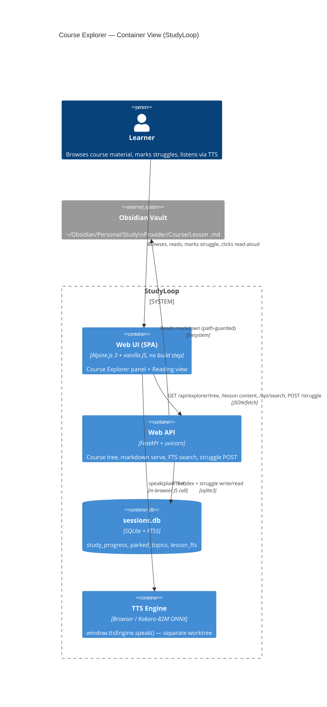

# Course Explorer Side Panel — Viability Assessment

**Date:** 2026-06-01
**Worktree:** `.claude/worktrees/course-explorer-panel` (branch `worktree-course-explorer-panel`)
**Method:** 6-agent parallel fan-out — 3 code-review (web UI / backend / session-db), 2 research (markdown+mermaid / tree+carousel+search), 1 TTS-integration scout.

---

## TL;DR — Verdict: **GO** (high confidence)

Building a course-material explorer side panel is **highly viable** and lands almost entirely on **existing infrastructure**. The hard parts are already solved in the codebase:

- The frontend render pipeline libs (`marked`, `DOMPurify`, `highlight.js`) are **already vendored and loaded**. Only **mermaid** and **Fuse.js** are net-new dependencies.
- The backend is **FastAPI + uvicorn** with an established router pattern, a **working path-traversal guard** to copy (`artefacts.py`), **3-level content discovery**, and an endpoint that already lists lesson files (`GET /api/courses/{course}/sections`).
- The configured content root `~/Obsidian/Personal/Study` is **already wired** as `content.base_path` in live config — the exact path in the goal.
- The struggle-topic read + spaced-repetition pipeline is **fully built**; once a `study_progress` row exists with `confidence='struggling'`, it surfaces in the study session and drives deck generation automatically.

**The only genuinely new work:** (1) two backend endpoints (course tree + serve-markdown), (2) one SQLite FTS5 table + search endpoint for body search, (3) one new Alpine panel + reading view in the frontend, (4) one DB migration + one POST endpoint to record a user-flagged struggle with course/section provenance.

**Net assessment:** ~80% reuse, ~20% new. No architectural blockers. The feature composes cleanly with the in-flight TTS worktree via a documented, decoupled contract (`window.ttsEngine.speak(plainText)`).

---

## ⚠️ Scope & accuracy caveat (read first)

This worktree was branched from `origin/main`. **It is behind the `feat/settings-providers-panel` branch**, which holds the latest web UI and — critically — the vendored render libs (`marked`, `DOMPurify`, `highlight.js`) and the TTS work.

The review agents deliberately audited the **main working checkout** (`/Users/taylaand/code/personal/tools/StudyLoop/...`, currently on `feat/settings-providers-panel`), so **every `file:line` reference in this document and PLAN.md is against that branch's code, not this worktree's HEAD.**

**Implication for implementation:** before coding in this worktree, rebase/merge it onto the branch that contains the vendored libs and current web UI. Otherwise the referenced files (`tts-engine.js`, the vendored `marked`/`purify`/`hljs`, the settings panel) will be missing or stale. See `stale-install-masks-fixes` memory — reinstall the `studyloop` uv-tool + editable venv after branch sync, before any verify.

---

## C4 Container View — where the feature sits



---

## Findings by domain

### 1. Web UI (Alpine.js, no build step) — **viable, idiomatic path exists**

- **Stack:** Alpine.js 3.14.8 (vendored UMD) + HTMX (SSE feed only) + vanilla `fetch`. No router; `$store.nav` + `window.location.hash` switches `x-show` view blocks. No module system — components are global factory functions in `index.html` inline script or `components.js`.
- **Layout slot:** `.app-layout` is a CSS grid `grid-template-columns: 200px 1fr` (`style.css:189`). The explorer becomes a **3rd column**: `200px 260px 1fr`, with a new `<aside>` between `.sidebar` and `.content-area`.
- **Render libs already loaded:** `marked@12`, `DOMPurify@3.1`, `highlight.js@11.9` are vendored at `/static/vendor/`. **A `_renderMarkdown()` helper already exists** (`index.html:2672`) doing `marked.parse → DOMPurify.sanitize → hljs.highlightElement`. It is currently trapped as a closure inside `liveAgentConsole()` — must be **extracted to a top-level utility** for reuse (flagged as the most likely subtle-bug source).
- **Reading view pattern:** new `x-show` block + `courseReaderPanel()` factory; reuse the `.acp-message-final` prose CSS (`style.css:2250`).

**Top gotchas:** (a) global `header{display:flex}` cascades into nested headers — reset to `display:block` (this is the [[css-cascade-nested-header]] bug, already bitten once); (b) Alpine `x-show` views are **always in the DOM** — `init()` fires for all on load, so lazy-load the tree on first activation; (c) `_renderMarkdown` is not globally accessible today.

### 2. Backend (FastAPI) — **viable, ~80–100 lines of genuinely new route code**

- **Reusable as-is:** `GET /api/courses/{course}/sections` → `[{slug,name}]` lesson list; `GET /api/content/publishers` + `/api/content/courses` → the 3 tree levels separately; `_validate_artefact_path()` (`artefacts.py:15`) → **copy verbatim** for traversal safety; `content/scope.py:_iter_source_files()` → walks course dir, skips output dirs.
- **Discovery already 3-level:** `review_loader.discover_directories()` walks to depth 4 (the [[gen-readpath-two-config-keys]] fix); `content/discovery.discover_materials()` does unlimited `rglob` and returns rich `DiscoveredMaterial` (title, kind, size, modified_at).
- **Config confirmed:** `content.base_path: ~/Obsidian/Personal/Study` is live. This is the right read-root for showing *all* courses (including those without generated decks).
- **Net-new:** (1) a single nested course-tree endpoint, (2) a serve-markdown-by-path endpoint (guarded + suffix allowlist `.md/.markdown/.txt`), (3) response caching (current discovery does uncached `rglob` per request).

### 3. Session DB / struggle topics — **viable, needs 1 migration + 1 endpoint**

- **Engine:** SQLite (WAL) at `~/.config/studyloop/sessions.db`, forward-only migrations (currently v21).
- **Authoritative struggle store:** `study_progress(topic, concept, confidence, ...)`. `confidence='struggling'` is what `get_struggling_topics()` reads and what `content/scope._resolve_topic_struggles()` queries to generate decks. **Read + spaced-rep pipeline is already complete.**
- **Gap:** `study_progress` has **no course/section/publisher FK** — `topic`/`concept` are free text. **No web endpoint writes a struggle today** (only session-end bulk-drain, CLI, or MCP `log_topic`).
- **Fix:** migration **v22** adds `source_course`, `source_section`, `source_publisher`, `created_by` (all nullable → backward compatible); new `POST /api/history/struggling-topics` calls `record_progress(...)` with provenance. Once the row exists, **everything downstream already works**.

### 4. Markdown + Mermaid rendering — **pipeline is decided**

Recommended ordered pipeline (security ordering is load-bearing):

```
fetch md → strip frontmatter → marked.parse → DOMPurify.sanitize
        → container.innerHTML → hljs.highlightElement(per pre>code)
        → mermaid.run(pre.mermaid)   [await]
```

- **marked** (already vendored) intercepts ```mermaid fences → `<pre class="mermaid">` (do NOT escape the diagram text).
- **DOMPurify** (already vendored) sanitizes the HTML string **before** `innerHTML` — never after. Mermaid generates its SVG *after* injection from raw diagram text, so the "don't modify after sanitize" rule is not violated.
- **mermaid v11** (NET-NEW, ESM, ~750KB gzip) — `initialize({startOnLoad:false, securityLevel:'strict'})`, re-render by always overwriting `innerHTML` fresh (never run on an already-rendered SVG).
- **Obsidian extras:** callouts `> [!note]` + `==highlights==` are v1-nice-to-have (custom marked extension, or switch to `markdown-it` + plugins); `[[wikilinks]]` + `![[embeds]]` defer to v2 (need a vault index).

### 5. Tree / carousel / fuzzy search — **two-tier search, CSS-first carousel**

- **Tree load:** two-phase lazy — providers+courses on open (~5KB), lessons per-course on expand (cached in an Alpine store). Avoids ~2000 lesson objects upfront.
- **Carousel:** **CSS scroll-snap** (`scroll-snap-type:x mandatory` + `scroll-snap-align:start`), ~10 lines JS for prev/next buttons. Zero dependency. A library (Swiper) is only justified for touch-momentum — not needed on a desktop study app.
- **Search is two problems:**
  - **Titles** (provider/course/lesson) → **Fuse.js** (NET-NEW, 8.6KB gzip), client-side, instant, typo-tolerant. Use `ignoreLocation:true` (non-obvious but essential) + `includeMatches` for highlight.
  - **Body terms** (e.g. "window functions" inside lesson text) → **SQLite FTS5** server-side (`tokenize='porter unicode61'` so "decorators"≈"decorator"), `bm25()` weighting title>body, `snippet()` for excerpts.
  - UX: debounce 250ms, show client title-hits instantly, merge server body-hits (~20-50ms) by dedup on `lesson_id`.

### 6. TTS integration — **decoupled contract documented**

- TTS is **100% browser-side** (Kokoro-82M ONNX via transformers.js, WebGPU/WASM, Web Speech fallback). No server endpoint.
- **Contract:** reading view calls `window.ttsEngine.speak(plainText)` / `.stop()`. It must **convert rendered markdown → clean plain text first** (strip `#`, `**`, code fences, list markers; keep `\n` paragraph breaks). The engine owns sentence-splitting/chunking — do **not** pre-split.
- **Events:** subscribe to `window` `tts:state-change` (`state==='speaking'`) — do NOT couple to `$store.settings.isSpeaking`. **No word-level/karaoke highlight exists** (would be future TTS work).
- The TTS worktree is functional but **lives on its own branch**; main still uses raw `speechSynthesis`. The two features compose without coupling via `window.ttsEngine`.

---

## Risk register

| # | Risk | Severity | Mitigation |
|---|------|----------|------------|
| R1 | **Path traversal** on serve-markdown endpoint | 🔴 High | Copy `_validate_artefact_path()` (`.resolve()` + `is_relative_to`), reject `..` in parts pre-resolve, suffix allowlist. ARCC: file-access domain. |
| R2 | **XSS** via markdown content | 🟡 Med (trusted-local, defense-in-depth) | DOMPurify already in pipeline; sanitize before `innerHTML`; mermaid `securityLevel:'strict'`. |
| R3 | Worktree is behind feat branch — stale file refs / missing vendored libs | 🟡 Med | Rebase/merge onto the lib-bearing branch first; reinstall uv-tool ([[stale-install-masks-fixes]]). |
| R4 | `_renderMarkdown` trapped in a closure; duplication drift | 🟡 Med | Extract to a top-level util in `components.js` once; both reading view and live console use it. |
| R5 | Nested-header CSS cascade regression | 🟡 Med | `display:block` reset on any panel header ([[css-cascade-nested-header]]); add geometry assertion ([[ui-verification-protocol]]). |
| R6 | Uncached `rglob` per request on a large vault | 🟡 Med | Cache the tree in app state; invalidate on mtime or TTL. |
| R7 | Mermaid bundle ~750KB gzip | 🔵 Low | Lazy-load mermaid only when a lesson with a ```mermaid fence is opened. |
| R8 | Alpine views always in DOM → eager `init()` fetches | 🔵 Low | Lazy-fetch tree on first panel activation, not in `init()`. |
| R9 | Struggle data model: free-text vs FK | 🔵 Low | v22 migration adds nullable provenance columns; old rows stay valid. |
| R10 | FTS index staleness vs vault edits | 🔵 Low | Reindex on ingest; delete+reinsert by rowid on file change. |

---

## What this is NOT (scope guard)

- **Not** the TTS engine — that's the `browser-neural-tts` worktree. This feature only *calls* it.
- **Not** an Obsidian-feature-complete renderer — wikilinks/embeds are explicitly v2.
- **Not** a write-back-to-vault editor — read-only rendering + a struggle marker.
- **Not** a replacement for the existing review/flashcard flow — it feeds it (struggles → decks).
