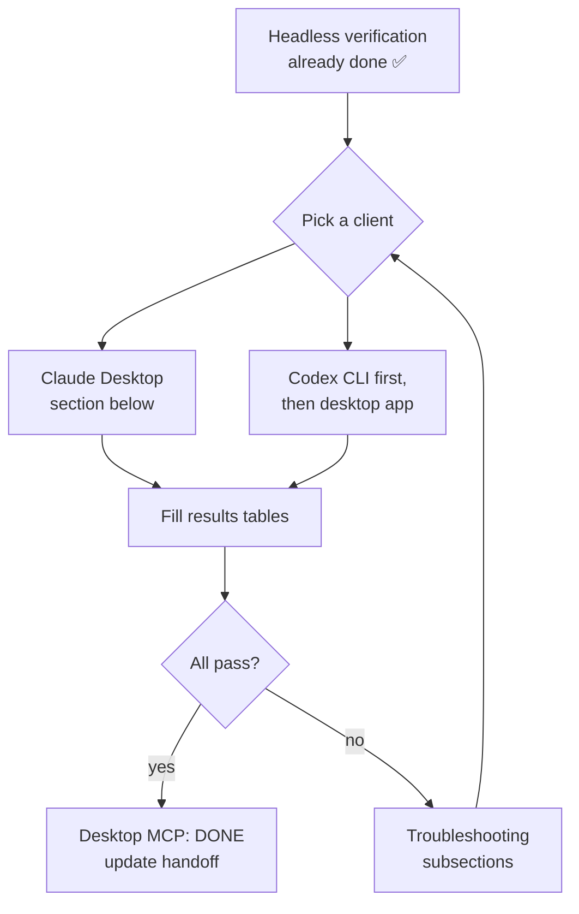
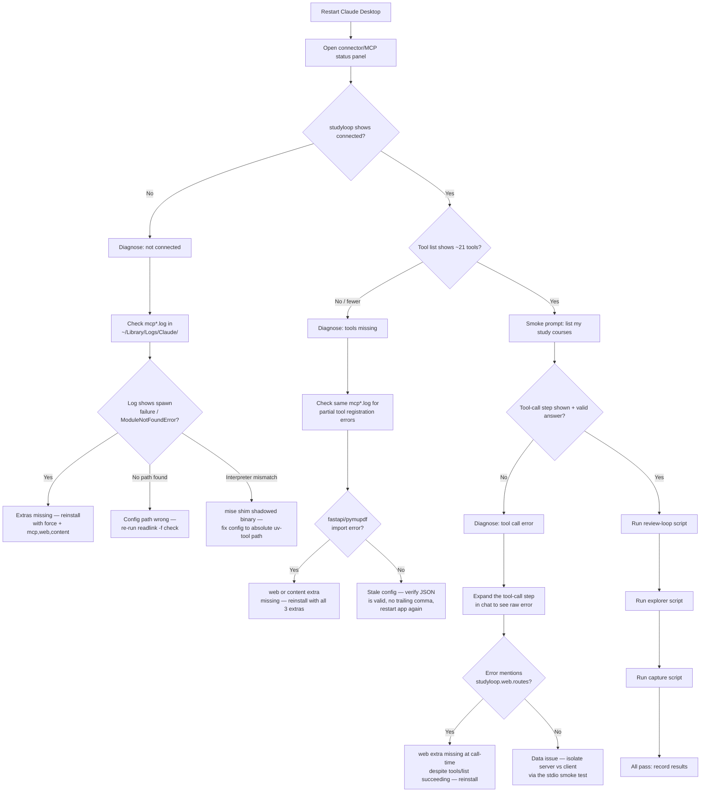
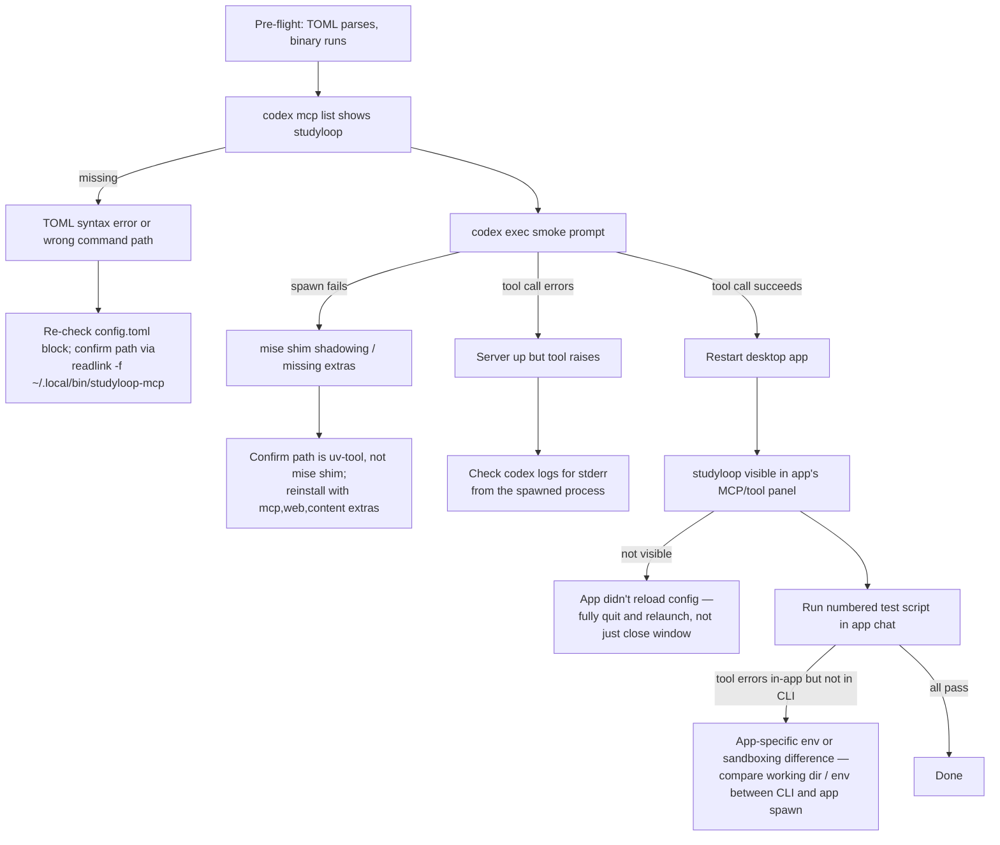

# Desktop MCP Manual Test Plan

The ~10-minute human click-through that verifies `studyloop-mcp` works inside
**Claude Desktop** and **Codex** (desktop app + CLI). Everything scriptable has
already been verified headless (stdio handshake → 21 tools → real tool calls
against the live vault); this plan covers only what needs human eyes inside
the chat apps.

## Shared context (read once)

- **Server binary (use this exact path in configs):**
  `/Users/taylaand/.local/share/uv/tools/studyloop/bin/studyloop-mcp`
  — never trust `which studyloop-mcp` on this machine: it resolves to a
  broken mise shim (see `README.md`).
- **Install (extras required):**
  `uv tool install --force './packages/studyloop[mcp,web,content]'`
- **Both app configs are already wired** (2026-07-12), with timestamped
  backups alongside each file.
- **Expected absences (not failures):** live PTY terminal / body-double,
  push notifications, in-chat TTS audio — impossible over MCP stdio by
  protocol design (see `README.md` § What works vs. what's impossible).

## Overall flow



## Claude Desktop

### Pre-flight checklist

- [ ] Server installed with required extras: `uv tool install --force './packages/studyloop[mcp,web,content]'` (bare install crashes with `ModuleNotFoundError: No module named 'mcp'`)
- [ ] Binary path sanity check — confirm the config points at the real uv-tool binary, not a mise/asdf shim:
  ```bash
  readlink -f ~/.local/bin/studyloop-mcp
  # must resolve to: /Users/taylaand/.local/share/uv/tools/studyloop/bin/studyloop-mcp
  ```
  If `which studyloop-mcp` disagrees with this, ignore `which` — it resolves to a broken mise shim on this machine.
- [ ] `~/Library/Application Support/Claude/claude_desktop_config.json` contains a `studyloop` entry under `mcpServers` pointing at the exact path above, merged alongside the existing `obsidian-mcp-tools`, `RepoPrompt`, `RepoPromptCE`, and `Home Assistant` entries (already done; timestamped backup exists next to the file).
- [ ] Claude Desktop has been **fully restarted** (quit and relaunch, not just closed the window) since the config was last edited — it only reads MCP config at startup.

### Test flow



### Numbered test script

Type these prompts verbatim into a fresh Claude Desktop conversation. "Expected" describes what should be observable in the UI, not internal implementation.

| # | Prompt | Expected behaviour |
|---|--------|---------------------|
| 1 | *(no prompt — inspect UI)* | The MCP/connector indicator (hammer or plug icon near the message input) shows `studyloop` as connected. Opening it lists ~21 tools including `list_courses`, `get_due_cards`, `get_next_action`. |
| 2 | `List my study courses.` | A tool-call step appears (expandable in the transcript) invoking `list_courses`; the reply enumerates real courses with card/review counts pulled from the vault. |
| 3 | `What cards are due for review right now?` | Tool-call step invokes `get_due_cards`; reply lists due flashcards (or states none are due) grounded in real data. |
| 4 | `I got the first one right.` (sent immediately after #3, same conversation) | Tool-call step invokes `log_review_outcome`; reply confirms the outcome was recorded, referencing the card/topic from #3. |
| 5 | `What should I study next? I have 25 minutes and medium energy.` | Tool-call step invokes `get_next_action`; reply gives one concrete recommended action sized to the stated time/energy constraints. |
| 6 | `Show me my course tree.` | Tool-call step invokes `get_lesson_tree`; reply shows a providers → courses → lessons hierarchy (e.g. ArjanCodes / CodeWithMosh / Udemy). |
| 7 | `Read the intro lesson of <course name from #6>.` | Tool-call step invokes `read_lesson`; reply renders the lesson's markdown content. |
| 8 | `Search my lessons for "closures".` | Tool-call step invokes `search_lessons`; reply lists matching lessons with `<mark>`-highlighted excerpts around "closures". |
| 9 | `Park this thought: I keep confusing decorators and higher-order functions.` | Tool-call step invokes `log_topic` and/or `log_struggle`; reply confirms the note was captured for later review. |

### Results

| # | Test | Expected | Pass/Fail | Notes |
|---|------|----------|-----------|-------|
| 1 | Connector status + tool list | `studyloop` connected, ~21 tools visible | | |
| 2 | List courses | `list_courses` call, real course data | | |
| 3 | Due cards | `get_due_cards` call, real due-card data | | |
| 4 | Log review outcome | `log_review_outcome` call, confirmation | | |
| 5 | Next action | `get_next_action` call, time/energy-aware suggestion | | |
| 6 | Lesson tree | `get_lesson_tree` call, provider hierarchy | | |
| 7 | Read lesson | `read_lesson` call, markdown rendered | | |
| 8 | Search lessons | `search_lessons` call, highlighted excerpts | | |
| 9 | Capture thought | `log_topic`/`log_struggle` call, confirmation | | |

### Troubleshooting (ordered by likelihood)

1. **`studyloop` shows disconnected in the connector panel.** Almost always the config path or a stale mise shim. Re-run `readlink -f ~/.local/bin/studyloop-mcp` and diff it against the `command` value in `claude_desktop_config.json` — they must match exactly, character for character. Then check `~/Library/Logs/Claude/mcp*.log` for a spawn failure or `ModuleNotFoundError: No module named 'mcp'` (means the extras weren't installed, or `which`-based tooling silently substituted the mise shim when the config was written). Fix: reinstall with `uv tool install --force './packages/studyloop[mcp,web,content]'`, re-verify the path, fix the config, fully restart the app.

2. **`studyloop` connects but tool list is short or missing entries.** Check the same log for import errors mentioning `fastapi` or `pymupdf` — these surface only when a tool that needs the `web` or `content` extra is registered/called, since `tools/list` can succeed even when those extras are absent. Fix: reinstall with all three extras (`mcp,web,content`).

3. **Config edits aren't taking effect.** Claude Desktop only reads `claude_desktop_config.json` at launch. A reload/refresh inside the app is not enough — fully quit (Cmd+Q, not just closing the window) and relaunch. Also validate the JSON is well-formed (no trailing commas, no comments — Claude Desktop's config is strict JSON) since a parse failure can silently drop the whole `mcpServers` block or just the malformed entry.

4. **A specific tool call errors mid-conversation** (e.g. `get_lesson_tree` fails even though `list_courses` worked). Expand the tool-call step in the transcript to see the raw error text. If it references `studyloop.web.routes` or an import error, that's the `web`-extra-missing pattern from #2 slipping through because `tools/list` doesn't exercise the import — reinstall fixes it. If the error looks data-related (empty result, path not found) rather than an import/module error, isolate server vs. client by running the same tool through the stdio smoke test (`uv run pytest packages/studyloop/tests/test_mcp_stdio_smoke.py -m integration`) — if that passes, the issue is Desktop-side (stale conversation state, wrong course name in the prompt), not the server.

5. **Structurally expected absences — not bugs.** If a prompt implicitly expects a live terminal session, a push notification, or in-chat audio playback, its absence is correct behavior, not a defect: MCP stdio is request/response-only, and desktop chat clients can't render a live PTY stream, receive server-initiated pushes, or play inline audio. These belong to the StudyLoop web UI (`studyloop web`), not the desktop MCP integration. Do not file these as failures.

## Codex (desktop app + CLI)

### Pre-flight checklist

Run these before touching the desktop app — they isolate config problems from app problems, since `~/.codex/config.toml` serves both surfaces.

```bash
# 1. Config block present and well-formed
grep -A2 'mcp_servers.studyloop' ~/.codex/config.toml

# 2. TOML parses cleanly
python3 -c "import tomllib; tomllib.load(open('/Users/taylaand/.codex/config.toml','rb'))" && echo "TOML OK"

# 3. Binary runs and speaks MCP stdio (use the uv-tool path, never `which studyloop-mcp`)
echo '{"jsonrpc":"2.0","id":1,"method":"initialize","params":{"protocolVersion":"2024-11-05","capabilities":{},"clientInfo":{"name":"probe","version":"0"}}}' | \
  /Users/taylaand/.local/share/uv/tools/studyloop/bin/studyloop-mcp

# 4. Codex's own view of the server (CLI-first — fastest way to isolate config from app)
codex mcp list

# 5. CLI smoke test — no desktop app needed
codex exec "list my study courses"
```

Step 5 is the key isolation step: if `codex exec` calls `list_courses` successfully, the config and server are fine and any desktop-app failure is app-specific (needs restart, or a stale cached server list). If `codex exec` fails, don't touch the desktop app yet — fix the CLI path first.

**Restart requirement**: both `codex exec`/interactive CLI and the desktop app cache the MCP server list at process start. After any config.toml edit, kill and restart both — a running desktop app will not pick up a new `[mcp_servers.studyloop]` block.

### Test flow



### Numbered test script

Run each prompt in the Codex desktop app chat (after confirming step 5 of pre-flight passes via CLI first).

1. **Server visibility** — open the app's MCP/tool/connector panel (exact location varies by Codex app version — look for a tools, connectors, or MCP servers list). Expect `studyloop` listed with its tool count.
2. **Course list** — prompt: `"List my study courses."` Expect a tool-call step showing `list_courses`, followed by a course list in the reply.
3. **Review turn** — prompt: `"What flashcards are due for review?"` Expect `get_due_cards`. Then: `"I got that one right, log it."` Expect `log_review_outcome` with the correct card/outcome inferred from context.
4. **Next action with params** — prompt: `"I have low energy and about 15 minutes — what should I study?"` Expect `get_next_action` called with energy/time constraints reflected in its arguments.
5. **Explorer walk** — prompt: `"Show me the lesson tree for [course]."` → `get_lesson_tree`. Then: `"Open the first lesson."` → `read_lesson`. Then: `"Search my lessons for 'decorators'."` → `search_lessons`.
6. **Park a thought** — prompt: `"I want to park this thought: I'm still confused about Python decorators, come back to it later."` Expect `log_topic` and/or `log_struggle` called with the decorators topic.

### Results

| # | Test | Expected tool(s) | Pass/Fail | Notes |
|---|------|-------------------|-----------|-------|
| 1 | Server visible | — (n/a, list only) | | |
| 2 | List courses | `list_courses` | | |
| 3 | Review turn | `get_due_cards`, `log_review_outcome` | | |
| 4 | Next action | `get_next_action` | | |
| 5 | Explorer walk | `get_lesson_tree`, `read_lesson`, `search_lessons` | | |
| 6 | Park thought | `log_topic`, `log_struggle` | | |

### Troubleshooting (ordered by likelihood)

1. **`codex mcp list` doesn't show `studyloop`** — TOML syntax error upstream of the block, or the block landed in the wrong table. Re-run the `python3 -c "import tomllib..."` check; a parse failure anywhere in the file hides every server below the error.
2. **Spawn fails / `ModuleNotFoundError: No module named 'mcp'`** — the configured `command` path resolved to the mise shim (`~/.local/share/mise/installs/python/*/bin/studyloop-mcp`) instead of the uv-tool binary. Re-run `readlink -f ~/.local/bin/studyloop-mcp` and confirm the config.toml path matches exactly — never trust bare `which studyloop-mcp`.
3. **Server spawns but `get_lesson_tree`/`read_lesson`/`search_lessons`/`list_session_options`/`end_session` raise at call time while `tools/list` succeeds** — installed without the `web` extra. Reinstall: `uv tool install --force './packages/studyloop[mcp,web,content]'`.
4. **CLI (`codex exec`) works but the desktop app doesn't see the server** — app is caching a stale MCP server list from before the config edit. Fully quit the app (not just close the window) and relaunch.
5. **Tool call succeeds but result looks wrong/stale** — run the repo's stdio smoke test: `uv run pytest packages/studyloop/tests/test_mcp_stdio_smoke.py -m integration`. If that passes but the desktop app's result differs, the discrepancy is app-side, not server-side.
6. **No obvious error, just silence** — prefer Codex's own diagnostics (`codex mcp list`, the app's MCP panel) over grepping log files; Codex's runtime logs are not plain text.

**Expected absences (do not test, document as structurally impossible):** live PTY terminal, push notifications, in-chat audio — MCP stdio is request/response only; see `docs/desktop-mcp/README.md` for the full rationale.

