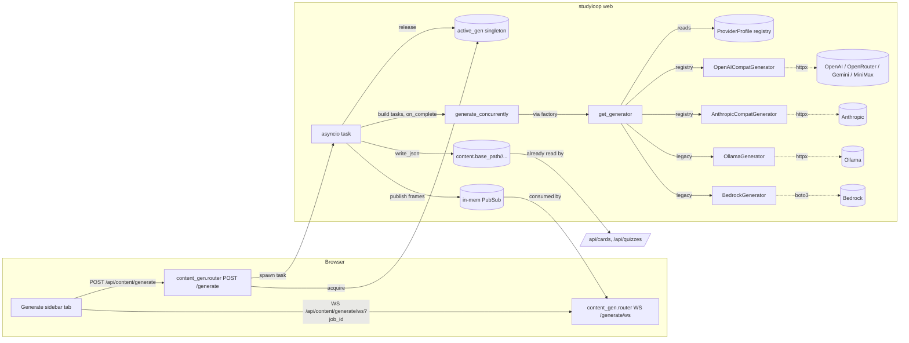

# Plan — feat(web): content generation panel

**Date**: 2026-05-29
**Status**: Draft — awaiting approval before execute
**Predecessor brainstorm**: `docs/handoffs/2026-05-28-end-session-acp-hotfix-brand-brainstorm.md` §"Generation panel for the WebUI"
**Driving evidence**: existing `studyloop content generate-cards` CLI works; Web UI has no equivalent. Reviewer (`/cards`, `/quizzes` views) already loads from disk via `web/routes/cards.py` — generation is the missing producer half of the loop.

---

## TL;DR

Add a **Generate** sidebar tab to the WebUI that drives the existing `content/generators/` pipeline (Bedrock + Ollama backends already shipping). One new REST endpoint to kick off a job, one WebSocket endpoint to stream progress, one new singleton (`session/active.py`-shaped) so two concurrent generations can't trash the local Ollama. Output paths and JSON shape match what the existing `cards.py` reviewer already reads — so generated decks light up automatically in `/cards` and `/quizzes` with zero coupling.

**v1 scope**: Course / Section / Topic-from-struggles scopes against a stub-or-real backend. **v1 explicitly excludes** agent-marked struggles mid-session (carry-forward as v2 / scope B in the brainstorm) — that's a separate plan.

**Out of scope**: new backends, new generator schemas, NotebookLM audio/video (already covered by `content notebooklm-generate`), syllabus-aware splitting (`content split` covers this).

---

## What already exists (reuse, do not rebuild)

| Component | Path | Role |
|---|---|---|
| `CardGenerator` Protocol + `get_generator()` factory | `packages/studyloop/src/studyloop/content/generators/__init__.py` | Backend-agnostic seam (Ollama / Bedrock) |
| Concurrent runner with `on_complete` callback | `packages/studyloop/src/studyloop/content/generators/runner.py` | Already supports streaming progress via callback — perfect WS seam |
| CLI `content generate-cards` | `packages/studyloop/src/studyloop/cli/_content.py:257-336` | Reference impl: builds `GenerationTask` list, runs `generate_concurrently`, writes via `FlashcardDeck.write_json` / `QuizDeck.write_json` |
| Output schemas + `write_json` | `packages/studyloop/src/studyloop/content/schemas.py` | `FlashcardDeck` / `QuizDeck` already validated by reviewer |
| Output dir helper | `packages/studyloop/src/studyloop/content/storage.py` (`get_course_dir`, `slugify`) | Same paths the reviewer reads |
| Active-session singleton (pattern to mirror) | `packages/studyloop/src/studyloop/session/active.py` | One module, three async fns, asyncio.Lock-guarded — exact shape the new singleton copies |
| Sessions struggle data | `study_progress` table; query at `history/sessions.py:244` | Filter `confidence='struggling'`, group by `topic`, window by `last_seen` |
| Sidebar nav + view-switcher | `packages/studyloop/src/studyloop/web/static/index.html:141-185` (nav), Alpine `$store.nav` at line ~1055 | Add a new button + a new content view, no framework change |
| WS pattern reference | `web/routes/session.py:1132-1268` (`/api/session/ws`) | JSON-frame protocol with `accept` → typed frames → close — copy this shape |

---

## Architectural choice (decided)

### A. Reuse the existing CLI pipeline; expose it over HTTP+WS. Do NOT introduce a new agent or generator.

Why: the brainstorm already weighed this. The CLI's `generate_cards` flow is the canonical producer; duplicating it as a "web generator" would split the truth. The endpoint becomes a **thin orchestrator** that builds `GenerationTask` instances, runs `generate_concurrently` with a callback that publishes WS frames, and writes the result. Same code path the CLI uses.

### B. Active-generation singleton mirrors `session/active.py`.

Why: same invariant ("one process, one heavy LLM job"), same constraint shape (local Ollama serialises decoding; concurrent jobs degrade everyone), same teardown ergonomics (idempotent `release()`). Copying the file shape costs nothing and makes the codebase more legible — two parallel singletons read the same way.

```
session/active.py        → ActiveSession    (study_session_id, transport, config)
content/active_gen.py    → ActiveGeneration (job_id, runner_handle, request)
```

### C. WS+REST split — REST kicks the job, WS streams progress.

Why: matches the existing `/api/session/start` (REST) + `/api/session/ws` (WS) pair. Browsers handle this pattern fluently; client only needs to know `job_id` from the REST response to subscribe to the WS topic.

```
POST /api/content/generate         → 202 Accepted, body = {job_id, plan: {kind, count_estimate, ...}}
WS   /api/content/generate/ws?job_id=...  → frames: started, task_complete, all_done, error, end
```

The 202 lets us validate inputs synchronously (course exists, scope source resolves to ≥1 file, count is sane) and reject bad requests before opening a WS. Acceptance ≠ completion — the WS is the source of truth for "done".

### D. Existing-file handling: prompt at planning time, not generation time.

Why: the brainstorm called for Overwrite / Merge / New-Suffix. Doing this **before** kicking off generation is much cheaper than a multi-second LLM run that then asks "what now?" The REST endpoint accepts an explicit `on_existing: "overwrite" | "merge" | "suffix"` flag. The WebUI shows the dialog **before** sending the POST. No mid-flight prompts.

### E. Pluggable provider abstraction — two adapter classes cover almost everything.

The brief lists Gemini, OpenRouter, MiniMax, OpenAI, Anthropic alongside the existing Bedrock + Ollama. The trap is shipping five new backend files. The reality:

| Provider | Native API | Realistic adapter |
|---|---|---|
| Anthropic | Messages API (tool-use) | **Anthropic-compat adapter** |
| Bedrock | Converse API (tool-use) | Already shipped (`bedrock.py`) — keep, do not refactor |
| OpenAI | Chat Completions (tool-use) | **OpenAI-compat adapter** |
| OpenRouter | OpenAI-compat passthrough | **OpenAI-compat adapter** (just `base_url`) |
| Gemini | Native + OpenAI-compat endpoint | **OpenAI-compat adapter** (set `base_url=https://generativelanguage.googleapis.com/v1beta/openai/`) |
| MiniMax | Anthropic-compat shim at `/anthropic` | **Anthropic-compat adapter** (set `base_url=https://api.minimax.io/anthropic`, auth_env=`MINIMAX_API_KEY` → `x-api-key`) |
| Ollama | Native + OpenAI-compat endpoint | Already shipped (`ollama.py`) — keep |

So the work isn't five new generators. It's **two generic adapters** (`OpenAICompatGenerator`, `AnthropicCompatGenerator`) plus a **provider profile registry** that names which adapter, base URL, env-var auth, and curated model list each provider uses. Adding the **seventh** provider becomes a registry row.

```python
# provider_profiles.py — module-level registry, no class ceremony
@dataclass(frozen=True)
class ProviderProfile:
    slug: str                               # "openai", "openrouter", "gemini", "minimax", "anthropic"
    adapter: Literal["openai_compat", "anthropic_compat"]
    base_url: str
    auth_env: str                           # "OPENAI_API_KEY", "OPENROUTER_API_KEY", ...
    models: list[ModelEntry]                # curated list

@dataclass(frozen=True)
class ModelEntry:
    id: str                                 # "gpt-4o-mini", "anthropic/claude-haiku-4-5", ...
    label: str                              # "GPT-4o mini" — UI display
    thinking: bool                          # True for o1 / o3 / sonnet-thinking — affects timeout + UX hint
    cost_tier: Literal["cheap", "balanced", "premium"]
    notes: str = ""                         # "free tier 15 RPM" etc.
```

**The two adapters carry all spec-specific complexity** (auth header shape, message-format quirks, tool-result streaming, streaming-vs-batch, retry classification). The CLI's existing prompt templates and JSON-schema-tool pattern from `bedrock.py:258-269` translate directly to both.

**Curated models, not "any model"**: the WebUI shows the registry's `models` list; arbitrary IDs are not accepted. This is deliberate — quizz/flashcard quality varies wildly between models, and a thinking-model picked from a free-text field can quietly cost 10x and time out. The registry is the curation point.

**Adding a new provider** in this design = (a) one row in the registry, (b) curated model list, (c) one row in the `auth_env` reference doc. No code, no tests beyond the existing adapter test matrix parameterised over the registry.

**`backend` config field gains a structured form**: today `card_generator.backend: "ollama"` selects an entire backend. Add `provider:` (optional, defaults to backend for back-compat) and `model:` (optional, defaults to provider's first cheap-tier entry):

```yaml
card_generator:
  backend: openai_compat        # or anthropic_compat | ollama | bedrock
  provider: openrouter          # registry slug
  model: anthropic/claude-haiku-4-5   # one of provider.models[].id
  temperature: 0.1
```

Existing config (`backend: ollama`) keeps working — the loader treats bare `ollama`/`bedrock` as legacy single-tenant backends and skips the registry path.

---

## Architecture diagram



The job task **owns** the generator instance (acquires/closes it); WS handlers are pure consumers — no shared mutable state outside the PubSub bus and the singleton.

---

## REST contract

### `POST /api/content/generate`

**Request**:
```json
{
  "course": "DataCamp",
  "scope": {
    "kind": "course" | "section" | "topic_struggles",
    "course": "DataCamp",
    "section": "advanced-pandas",
    "topic_slug": "pandas",
    "window_days": 14
  },
  "kinds": ["flashcards", "quizzes"],
  "count_per_source": 10,
  "on_existing": "suffix",
  "backend": "openai_compat",
  "provider": "openrouter",
  "model": "anthropic/claude-haiku-4-5"
}
```

| Field | Type | Notes |
|---|---|---|
| `course` | str | One of the auto-discovered `Study/*` subdir names. Validated against disk. |
| `scope.kind` | enum | See "Scopes" below. |
| `scope.section` | str? | Required when `scope.kind == "section"`. Subdir under `Study/<course>/`. |
| `scope.topic_slug` | str? | Required when `scope.kind == "topic_struggles"`. Lowercase topic (matches `study_progress.topic`). |
| `scope.window_days` | int? | For `topic_struggles`. Defaults to 14. Bounded 1..90. |
| `kinds` | list[enum] | Subset of `["flashcards", "quizzes"]`. Empty rejected. |
| `count_per_source` | int | One of `5, 10, 15, 20, 25, 50`. |
| `on_existing` | enum | `overwrite \| merge \| suffix`. Default `suffix`. |
| `backend` | str? | `openai_compat \| anthropic_compat \| ollama \| bedrock \| stub`. Defaults to `settings.card_generator.backend`. |
| `provider` | str? | Registry slug. Required when `backend` is one of the `_compat` backends. Validated against `PROFILES`. |
| `model` | str? | Curated model id within the chosen provider. Defaults to provider's first cheap-tier entry. |

**Response** (202):
```json
{
  "job_id": "gen-7c3f1a8b",
  "plan": {
    "sources": [{"identifier": "advanced-pandas", "title": "Advanced Pandas"}],
    "task_count": 2,
    "kinds": ["flashcards", "quizzes"],
    "backend": "bedrock"
  }
}
```

**Errors**:
- `409 Conflict` — another generation is active (singleton held).
- `400 Bad Request` — invalid course / scope / counts.
- `404 Not Found` — `topic_struggles` returned zero rows in window.

### Scopes (v1)

| `scope.kind` | What it means | Source resolution |
|---|---|---|
| `course` | One deck per top-level subdir under `Study/<course>/`. | `[d for d in Path(course_dir).iterdir() if d.is_dir()]` — each becomes one `GenerationTask` (concatenate `.md` files within). |
| `section` | One deck for one named section. | `Study/<course>/<section>/` — single `GenerationTask`. |
| `topic_struggles` | One deck per topic flagged `struggling` in window. | `SELECT DISTINCT topic FROM study_progress WHERE confidence='struggling' AND last_seen > datetime('now', '-N days')` → for each topic, find a markdown source by topic_slug match. |

**v2 (carry-forward, separate plan)**: scope B — agent marks specific concepts mid-session as needing review; one-shot deck targets those concepts directly. Additive, does NOT block v1.

---

## WebSocket frame contract

Server → client only. Client sends nothing after the WS handshake.

```json
{"type": "started", "job_id": "gen-...", "task_count": 2}
{"type": "task_complete", "identifier": "advanced-pandas", "kind": "flashcards", "ok": true, "elapsed_s": 47.3, "path": "/Users/.../flashcards/advanced-pandas-flashcards.json"}
{"type": "task_complete", "identifier": "advanced-pandas", "kind": "quiz",       "ok": false, "elapsed_s": 12.1, "error": "JSON validation failed: ..."}
{"type": "all_done", "written": 1, "failed": 1}
{"type": "transport_error", "message": "..."}      // mirrors session WS shape
```

Close codes: `1000` normal, `4400` policy (origin / job_id mismatch), `4404` job not found.

---

## Singleton: `content/active_gen.py`

Same shape as `session/active.py`, fewer fields. Read that file before writing this one — copy the lock pattern verbatim.

```python
@dataclass
class ActiveGeneration:
    job_id: str
    request: GenerateRequest          # validated body
    started_at: datetime
    cancel_event: asyncio.Event       # for future cancel support; ignored in v1

_lock = asyncio.Lock()
_active: ActiveGeneration | None = None

async def acquire(job_id: str, request: GenerateRequest) -> ActiveGeneration: ...
async def current() -> ActiveGeneration | None: ...
async def release() -> None: ...
```

`acquire` raises `GenerationAlreadyActiveError` if `_active is not None`. Same teardown idempotency as session/active. **No** filesystem state file (the session module writes one for cross-process discovery; generation jobs are per-process and don't need it).

---

## Output paths (unchanged from CLI)

```
~/Obsidian/Personal/Study/<course>/flashcards/<identifier>-flashcards.json
~/Obsidian/Personal/Study/<course>/quizzes/<identifier>-quiz.json
```

For `on_existing="suffix"`: append `-N` where N is the smallest integer making the filename unique. Implemented in `storage.py` (new helper `next_unique_path(base, suffix)`).

For `on_existing="merge"`: load existing JSON, dedupe by `front` (flashcards) or `question` (quizzes), append, re-validate, re-write. Helpers in `schemas.py` (new `FlashcardDeck.merge_dedupe(other)` / `QuizDeck.merge_dedupe(other)`).

For `on_existing="overwrite"`: just write. No dialog at the backend — the dialog is in the WebUI before POST.

---

## Unit breakdown

### U1 — Stub backend for tests

**Touch**: `packages/studyloop/src/studyloop/content/generators/stub.py` (new).

**Why first**: the rest of the plan is meaningless without a way to test it that doesn't burn LLM quota. Bedrock is real money; Ollama is local-CPU-bound and slow.

**Changes**:
1. New file `stub.py` exposing `StubGenerator` that satisfies `CardGenerator` Protocol.
2. Configurable per-call latency (default 0 s) and configurable failure mode (`always_succeed` | `fail_after_n` | `fail_specific_titles`).
3. Returns deterministic decks: `n` cards/questions where `n = settings.card_generator.<sub>.count_per_chunk` (or hardcoded 10 if absent). Card content references the title so tests can assert source-mapping.
4. Wire into `get_generator()` factory: `if backend == "stub"` import and return.
5. Env-var hatch `STUDYLOOP_TEST_GENERATOR=stub` so e2e tests can flip it without touching config.

**Acceptance**:
- Unit test calls `get_generator(CardGeneratorConfig(backend="stub"))`, asserts produces a valid `FlashcardDeck` with N cards.
- Unit test asserts `fail_specific_titles=["bad"]` makes only those titles raise `CardGenerationError`.

**Tests**: `packages/studyloop/tests/test_content_stub_generator.py` — 4 tests (success, partial fail, latency, count).

**Estimated**: 25 min.

---

### U1.5 — Provider profile registry + two generic adapters

**Touch**:
- `packages/studyloop/src/studyloop/content/generators/provider_profiles.py` (new) — registry data only, no I/O.
- `packages/studyloop/src/studyloop/content/generators/openai_compat.py` (new) — `OpenAICompatGenerator`.
- `packages/studyloop/src/studyloop/content/generators/anthropic_compat.py` (new) — `AnthropicCompatGenerator`.
- `packages/studyloop/src/studyloop/content/generators/__init__.py` (extend `get_generator`).
- `packages/studyloop/src/studyloop/settings.py` (extend `CardGeneratorConfig` with optional `provider`, `model`).

**Why before scope/runner**: U3 onwards consume `get_generator()`; with the new abstraction in place, the runner doesn't care which provider is selected. Doing this once up-front means no provider-specific code leaks into `job.py` later.

**Changes**:

1. **`provider_profiles.py`** — pure data:
   - `ProviderProfile` and `ModelEntry` dataclasses (shapes shown in §E).
   - Module-level dict `PROFILES: dict[str, ProviderProfile]` populated for: `openai`, `openrouter`, `gemini`, `minimax`, `anthropic`.
   - Each provider's `models` list is **curated** — see "Curated model catalogue v1" below for what ships.
   - Helper `get_profile(slug: str) -> ProviderProfile`, `get_model(profile, model_id) -> ModelEntry` with clear errors.

2. **`OpenAICompatGenerator`** — one `httpx.Client`, one method `_chat_with_tool(...)` shared by `generate_flashcards` / `generate_quiz`:
   - POST `<base_url>/chat/completions` with `messages`, `tools=[{type:"function", function:{name, parameters: <schema>}}]`, `tool_choice={type:"function", function:{name}}`, `temperature`, `model=<model_id>`.
   - Auth: `Authorization: Bearer ${env[profile.auth_env]}` (raise `CardGenerationError` with actionable message if env var unset).
   - Read tool-call args, `model_validate` against the deck pydantic model, retry-with-correction loop **identical to `bedrock.py:271-312`** — extract that into a `retry_with_correction(call_fn, model_cls, max_retries)` helper in a new `_retry.py` and have both adapters + Bedrock use it (small refactor; cheap).
   - Thinking-model handling: if `model_entry.thinking == True`, multiply `request_timeout` by 3 (no other change — OpenAI o1/o3 expose no other knob over the API today).

3. **`AnthropicCompatGenerator`** — same shape:
   - POST `<base_url>/v1/messages` with Messages API `tool_use` shape (mirror Bedrock's tool-config since Bedrock IS Anthropic on AWS — the JSON shapes are nearly identical). Auth header: `x-api-key: ${env[profile.auth_env]}`, `anthropic-version: 2023-06-01`.
   - Same `retry_with_correction` helper.
   - Thinking-model handling: when model entry has `thinking=True`, set `thinking={"type":"enabled","budget_tokens":2000}` and 3x timeout. No streaming required (deck generation is one-shot).

4. **`get_generator()`** dispatch logic, updated:
   ```
   if backend in {"ollama", "bedrock"}:    # legacy path, unchanged
       return OllamaGenerator(config) | BedrockGenerator(config)
   if backend == "stub":
       return StubGenerator(config)
   if backend in {"openai_compat", "anthropic_compat"}:
       profile = get_profile(config.provider)
       model_entry = get_model(profile, config.model or profile.models[0].id)
       if backend == "openai_compat":
           return OpenAICompatGenerator(config, profile, model_entry)
       return AnthropicCompatGenerator(config, profile, model_entry)
   raise ValueError(...)
   ```

5. **`CardGeneratorConfig`** gains two optional fields:
   ```python
   provider: str = ""    # registry slug; empty = legacy single-tenant backends
   model: str = ""       # model id within profile; empty = profile.models[0].id
   ```

**Curated model catalogue v1** (the actual list shipped in `provider_profiles.py`):

| Provider | Model ID | Label | Tier | Thinking? | Notes |
|---|---|---|---|---|---|
| openai | `gpt-4o-mini` | GPT-4o mini | cheap | no | Solid default, schema-mode tool-call works |
| openai | `gpt-4o` | GPT-4o | balanced | no | |
| openai | `o3-mini` | o3 mini | premium | yes | Reasoning model — 3x timeout |
| openrouter | `anthropic/claude-haiku-4-5` | Claude Haiku 4.5 | cheap | no | OpenRouter routes to Anthropic |
| openrouter | `anthropic/claude-sonnet-4-6` | Claude Sonnet 4.6 | balanced | no | |
| openrouter | `google/gemini-3.5-flash` | Gemini 3.5 Flash | cheap | no | OpenRouter routes to Google |
| openrouter | `qwen/qwq-32b-preview` | Qwen QwQ 32B | balanced | yes | Reasoning model |
| gemini | `gemini-3.5-flash` | Gemini 3.5 Flash | cheap | no | OpenAI-compat endpoint at `https://generativelanguage.googleapis.com/v1beta/openai/`. 2.x deprecated. |
| gemini | `gemini-3.1-flash-lite` | Gemini 3.1 Flash Lite | cheap | no | Fastest/cheapest Gemini |
| gemini | `gemini-3.1-pro-preview` | Gemini 3.1 Pro (preview) | balanced | no | |
| minimax | `MiniMax-M2.7` | MiniMax M2.7 | balanced | no | **Anthropic-compat shim** at `https://api.minimax.io/anthropic`; auth via `MINIMAX_API_KEY` injected as `x-api-key`. Requires token plan. |
| anthropic | `claude-haiku-4-5` | Claude Haiku 4.5 | cheap | no | |
| anthropic | `claude-sonnet-4-6` | Claude Sonnet 4.6 | balanced | no | |
| anthropic | `claude-opus-4-7` | Claude Opus 4.7 | premium | no | |

Curation criteria: must have working **tool-use / structured-output mode** (no JSON-mode-only models — the deck schema needs tool-call constraint), must be reasonably current, and must produce decks at a viable cost-per-deck (<$0.05 for cheap tier, <$0.25 for balanced; premium left uncapped). The list lives in code so it's easy to PR-edit; it explicitly is **not** a config file (would invite users adding broken models).

**Acceptance**:
- `get_profile("openrouter")` returns a profile with the listed model entries.
- `get_generator(CardGeneratorConfig(backend="openai_compat", provider="openrouter", model="google/gemini-3.5-flash"))` returns an `OpenAICompatGenerator` configured against OpenRouter's base URL and validates env var.
- `get_generator(CardGeneratorConfig(backend="anthropic_compat", provider="minimax", model="MiniMax-M2.7"))` returns an `AnthropicCompatGenerator` whose base URL is `https://api.minimax.io/anthropic` and whose `x-api-key` header value is `${MINIMAX_API_KEY}` (verified via `respx` request-capture, not a real call).
- Missing env var → `CardGenerationError` with message naming the env var to set.
- Unknown provider slug → clear error listing available slugs.
- Unknown model id → clear error listing the profile's available models.

**`.env` file loading**: the user keeps API keys in a project-root `.env` file. Studyloop already runs as a long-lived web service, so a one-time load at process start is the right shape:
- Add `python-dotenv` to runtime deps (`uv add python-dotenv`).
- In `studyloop/__init__.py` (or earliest entry point that's NOT a CLI subcommand), call `dotenv.load_dotenv(override=False)` — `override=False` so an explicitly-set shell env var always wins over the file.
- `.env` is **already gitignored** (verified) — confirm before commit.
- Document expected keys in `.env.example` (committed): `OPENAI_API_KEY=`, `OPENROUTER_API_KEY=`, `GEMINI_API_KEY=`, `MINIMAX_API_KEY=`, `ANTHROPIC_API_KEY=` — empty values, just so contributors know the namespace.

**Tests**:
- `test_provider_profiles.py` — registry shape, get_profile / get_model error paths (8 tests).
- `test_openai_compat_generator.py` — uses `respx` to stub the HTTP layer; one test per: happy path, retry-on-validation-fail, missing env var, thinking-model timeout adjustment, tool-call extraction (5 tests).
- `test_anthropic_compat_generator.py` — same shape (5 tests).
- **Live smoke tests**, `@pytest.mark.live_provider` (excluded from default suite, opt-in only): one tiny generation per provider. User runs these manually to sanity-check creds and registry shape.

**Estimated**: 2.5 h. (One adapter is ~45 min; the second is ~20 min by copying; registry is ~30 min; tests are ~45 min.)

---

### U2 — Active-generation singleton

**Touch**: `packages/studyloop/src/studyloop/content/active_gen.py` (new), `packages/studyloop/src/studyloop/content/__init__.py` (export).

**Changes**:
1. Copy `session/active.py` shape — same lock semantics, same idempotent release, no `session_state` writes.
2. `GenerationAlreadyActiveError` exception class.
3. `acquire(job_id, request)`, `current()`, `release()` async fns.

**Acceptance**:
- Two concurrent `acquire` calls — second raises `GenerationAlreadyActiveError`.
- After `release`, `acquire` succeeds.
- `release()` is no-op when nothing active.

**Tests**: `packages/studyloop/tests/test_content_active_gen.py` — 5 tests mirroring `test_session_active.py` shape (lock contention, idempotent release, current() pointer-read).

**Estimated**: 30 min.

---

### U3 — Scope resolver

**Touch**: `packages/studyloop/src/studyloop/content/scope.py` (new).

**Changes**:
1. `resolve_scope(scope: ScopeRequest, settings: Settings) -> list[ResolvedSource]` pure function, no I/O dependencies on FastAPI.
2. `course` scope: list dirs under `<base_path>/<course>`, build one `ResolvedSource(identifier, title, markdown_text)` each by globbing `*.md` and concatenating (matches `_resolve_card_sources` in CLI at line 339).
3. `section` scope: same but scoped to one named subdir.
4. `topic_struggles` scope: query `study_progress` for distinct topics in window with `confidence='struggling'`, then for each topic find markdown by `<base_path>/<course>/**/<topic_slug>*.md` (case-insensitive). Skip topics with zero source matches.
5. Raises `ScopeResolutionError` on missing course / empty result.

**Acceptance**:
- All three scope kinds return non-empty `list[ResolvedSource]` for a fixture vault.
- `topic_struggles` with `window_days=0` returns empty (legitimate user expectation given the boundary).
- Missing course raises `ScopeResolutionError`.

**Tests**: `packages/studyloop/tests/test_content_scope.py` — 8 tests against a tmp-dir fixture vault and an in-memory sqlite `study_progress`.

**Estimated**: 60 min — most of the work is the fixture, not the resolver.

---

### U4 — Job runner (orchestrator)

**Touch**: `packages/studyloop/src/studyloop/content/job.py` (new).

**Changes**:
1. `async def run_job(job_id, request, settings, on_event)` — orchestrates the whole flow:
   - resolve scope (U3)
   - build `GenerationTask` list (mirrors CLI lines 286-303)
   - get generator from settings; respect `request.backend` override
   - call `generate_concurrently` with an `on_complete` callback that wraps the result into a `task_complete` event and calls `on_event`
   - apply `on_existing` policy when writing each deck (U6 helpers)
   - emit `started` before, `all_done` after
2. The function is sync at heart (CPU + httpx) — wrap with `loop.run_in_executor` from the FastAPI handler so the event loop stays responsive.
3. Always `release()` the singleton in a `finally`.

**Acceptance**:
- Given stub backend + fixture scope, `run_job` produces N json files on disk and emits `started`, N×`task_complete`, `all_done` in order.
- A failing task emits `task_complete` with `ok=False` and does not abort the run.

**Tests**: `packages/studyloop/tests/test_content_job_runner.py` — 6 tests (happy path, partial failure, on_existing variants, generator-unreachable, scope-empty rejection, singleton released on raise).

**Estimated**: 90 min.

---

### U5 — REST endpoint + router wiring

**Touch**: `packages/studyloop/src/studyloop/web/routes/content_gen.py` (new), `web/app.py` (one `include_router` line).

**Changes**:
1. Pydantic models: `ScopeRequest`, `GenerateRequest`, `GenerateResponse`, `JobPlan`.
2. `POST /api/content/generate`:
   - Validate body, call `resolve_scope`, build plan summary.
   - Acquire singleton with new `job_id = "gen-" + secrets.token_hex(4)`.
   - Spawn `asyncio.create_task(run_job(...))` — handler returns 202 immediately.
   - Job task publishes events to a per-`job_id` `asyncio.Queue` held in a module-level `_job_queues: dict[str, asyncio.Queue]`.
   - On 409 / 400 / 404: return error body `{detail: "..."}`, no singleton acquired.
3. Wire `app.include_router(content_gen.router, prefix="/api")`.

**Acceptance**:
- `curl POST .../api/content/generate` with a valid body returns 202 with a `job_id`.
- Same call again before completion returns 409.
- Invalid course returns 400 with explanatory `detail`.
- Singleton released after job completes (verifiable by hitting POST again with no 409).

**Tests**: `packages/studyloop/tests/test_web_content_gen_rest.py` — 7 tests using FastAPI's `TestClient` and the stub generator.

**Estimated**: 60 min.

---

### U6 — On-existing policy helpers

**Touch**: `packages/studyloop/src/studyloop/content/storage.py` (extend), `packages/studyloop/src/studyloop/content/schemas.py` (extend).

**Changes**:
1. `storage.next_unique_path(base: Path, stem: str, suffix: str) -> Path` — finds `<base>/<stem><suffix>` or `<base>/<stem>-1<suffix>`, etc.
2. `FlashcardDeck.merge_dedupe(other: FlashcardDeck) -> FlashcardDeck` — concatenates cards, dedupes by normalised `front`, returns new deck. Original objects untouched.
3. `QuizDeck.merge_dedupe(other: QuizDeck) -> QuizDeck` — same pattern, dedupe by normalised `question`.
4. Both helpers re-validate via `model_validate` so a bad merge fails loud, not silent.

**Acceptance**:
- `next_unique_path` with no existing returns base path; with one existing returns `-1` form; with two returns `-2`.
- `merge_dedupe` halves a deck merged with itself (full overlap).
- `merge_dedupe` of disjoint decks returns sum.

**Tests**: `packages/studyloop/tests/test_content_storage_merge.py` — 6 tests, no I/O for the deck merges (pure pydantic).

**Estimated**: 35 min.

---

### U7 — WS endpoint

**Touch**: `web/routes/content_gen.py` (extend U5 file).

**Changes**:
1. `@router.websocket("/content/generate/ws")` — accept, validate `origin` and `job_id` query param the same way `session.py:1167-1190` does.
2. Look up `_job_queues.get(job_id)`; if missing → `4404` close.
3. Loop: `await queue.get()`, `await ws.send_json(frame)`, exit when frame is `all_done` or `transport_error`.
4. On WS disconnect: continue draining queue silently (job keeps running; its events just go nowhere). On job error: forward `transport_error` then close.

**Acceptance**:
- Connect to WS for a known `job_id` → receive `started`, ≥1 `task_complete`, `all_done`, then close.
- Connect to WS for unknown `job_id` → close with code `4404`.
- Disconnect mid-stream → server logs at debug, no exception leaks.

**Tests**: `packages/studyloop/tests/test_web_content_gen_ws.py` — 5 tests using `TestClient.websocket_connect` paired with a stub-driven REST job.

**Estimated**: 50 min.

---

### U8 — WebUI: sidebar tab + view + form

**Touch**: `packages/studyloop/src/studyloop/web/static/index.html` (extend existing nav + content area), no new HTML files.

**Changes**:
1. Add `Generate` button to sidebar between `Quizzes` (line 158-163) and `Body Double` (line 164-169). Plus icon SVG + Alpine `$store.nav.go('generate')`.
2. Register `'generate'` in the `$store.nav` view set (line ~1055).
3. New content view `<section x-show="$store.nav.is('generate')">` with the form:
   - **Course** select (populated from `GET /api/courses` — already exists at `web/routes/courses.py`)
   - **Scope** radio group (Course / Section / Topic struggles)
   - **Section** select (shown when scope=section; populated from a lazy `GET /api/courses/<course>/sections` — new in U9)
   - **Topic** select (shown when scope=topic_struggles; populated from `GET /api/history/struggling-topics?days=14` — new in U10)
   - **Window days** input (shown when scope=topic_struggles; numeric, 1..90, default 14)
   - **Kinds** checkboxes (Flashcards / Quizzes; at least one required)
   - **Count** select (5/10/15/20/25/50)
   - **Provider** select (populated from `GET /api/content/providers` — new in U10.5; shows registry slugs that have a configured env var, e.g. unset `OPENROUTER_API_KEY` → OpenRouter is disabled in the dropdown with a tooltip explaining how to enable)
   - **Model** select (populated when provider changes from the registry; each option shows label + cost-tier badge + thinking-model badge where relevant)
   - **On existing** select (Overwrite / Merge / New suffix; default Merge — least destructive sensible default)
   - **Generate** button
4. Submit handler: validates client-side, POSTs JSON, opens WS on returned `job_id`, renders progress in a sibling `<div>`:
   - Progress bar `written / task_count`
   - Per-task line `<identifier> · <kind> · ✓/✗ · <elapsed>s`
   - Final summary on `all_done`
5. Disable form while a job is active; re-enable on `all_done` or `transport_error`.

**Acceptance** (manual + Playwright):
- Sidebar shows the new tab in the right slot.
- Submitting a valid form starts a job and progress events render.
- 409 (concurrent job) shows a non-modal banner, doesn't crash the UI.

**Tests**: `packages/studyloop/tests/test_web_content_gen_e2e.py` — 4 Playwright tests using stub backend (form submit happy path; 409 conflict UI; partial failure rendering; merge-dialog flow).

**Estimated**: 2 h.

---

### U9 — `GET /api/courses/<course>/sections`

**Touch**: `web/routes/courses.py`.

**Changes**:
1. New route returning `[{"slug": "...", "name": "...", "file_count": N}]` for `[d for d in (base/<course>).iterdir() if d.is_dir()]`.
2. Skip dot-dirs and the existing `flashcards/` / `quizzes/` output dirs.

**Acceptance**: returns sections for a course; 404 for missing course.

**Tests**: `packages/studyloop/tests/test_web_courses_sections.py` — 3 tests.

**Estimated**: 20 min.

---

### U10.5 — `GET /api/content/providers`

**Touch**: `web/routes/content_gen.py` (extend U5 file).

**Changes**:
1. New route returning a list of provider profiles, augmented with per-profile availability:
   ```json
   [
     {
       "slug": "openrouter",
       "label": "OpenRouter",
       "adapter": "openai_compat",
       "auth_env": "OPENROUTER_API_KEY",
       "available": true,
       "models": [
         {"id": "anthropic/claude-haiku-4-5", "label": "Claude Haiku 4.5",
          "tier": "cheap", "thinking": false}
       ]
     }
   ]
   ```
2. `available = bool(os.environ.get(profile.auth_env))` — providers with no creds are returned but flagged unavailable so the UI can disable them with an actionable hint.
3. Also includes the legacy backends (`ollama`, `bedrock`, `stub`) as pseudo-profiles so the WebUI has a single dropdown for everything; legacy ones expose their existing config-driven model field via `models: [{id: "<config.value>", ...}]`.

**Acceptance**:
- All registered profiles returned.
- `available` reflects env-var presence at request time (not cached).
- Legacy backends show up as single-model pseudo-profiles.

**Tests**: `packages/studyloop/tests/test_web_content_providers.py` — 4 tests (env present/absent, legacy backends present, model entries shape).

**Estimated**: 30 min.

---

### U10 — `GET /api/history/struggling-topics`

**Touch**: `web/routes/history.py`.

**Changes**:
1. New route, `?days=N` query param (default 14, bounded 1..90).
2. Calls a new helper `history.progress.get_struggling_topics(days)` — wraps the existing struggle query, groups by topic, counts concepts per topic.
3. Returns `[{"topic_slug": "pandas", "concept_count": 3, "last_seen": "..."}]`.

**Acceptance**: returns topics with struggling concepts in window; empty list for empty DB; 422 for out-of-range `days`.

**Tests**: `packages/studyloop/tests/test_web_history_struggling.py` — 4 tests against an in-memory sqlite fixture.

**Estimated**: 30 min.

---

### U11 — Documentation update

**Touch**: `docs/web-ui-guide.md`, `docs/architecture/current.md`, `docs/architecture/target.md`, `docs/system-overview.md`.

**Changes**:
1. **web-ui-guide.md**: new section `## Generate panel` — screenshots, scope explanations, on-existing semantics.
2. **architecture/current.md**: add a new C4 Component diagram for the generation flow (REST → singleton → runner → backends → disk → reviewer). Update the existing Container diagram if the lines need re-routing.
3. **architecture/target.md**: note the v2 (agent-marked struggles) extension as a planned arrow.
4. **system-overview.md**: bullet under "What's in the box" gains a Generate-panel line.
5. Run `mmdc` against every touched mermaid block before commit (per existing conventions).

**Estimated**: 45 min.

---

## Test strategy summary

| Layer | Approach | Quota burn? |
|---|---|---|
| Stub generator | Pure pytest unit | None |
| Provider registry | Pure pytest unit | None |
| Adapters (OpenAI-compat, Anthropic-compat) | `respx` HTTP stubbing | None |
| Singleton | Pure pytest async | None |
| Scope resolver | Tmp-dir + in-mem sqlite | None |
| Job runner | Stub backend, tmp-dir | None |
| REST endpoint | FastAPI TestClient + stub | None |
| Providers-list route | TestClient with mocked env | None |
| WS endpoint | TestClient.websocket_connect + stub | None |
| Storage helpers | Pure pydantic | None |
| WebUI | Playwright + `STUDYLOOP_TEST_GENERATOR=stub` | None |
| Live Bedrock smoke | One manual run before declaring v1 done; not in CI | ~$0.20 |
| Live Ollama smoke | One manual run pre-merge; not in CI | None |
| Live provider smoke (per provider) | Opt-in `@pytest.mark.live_provider`; **MVD** generation per configured provider | <$0.01 per run, only providers with env vars |

The whole automated suite runs without touching real LLMs. Live confidence runs are gated behind `@pytest.mark.live_bedrock`, `@pytest.mark.live_ollama`, and `@pytest.mark.live_provider` markers (mirrors `live_kiro` from the previous session) and run only when the flag is passed.

### Minimum viable data set for live provider smoke tests

The user has explicitly asked Gemini, MiniMax, and OpenRouter live tests stay **minimal** — these run with real API keys and bill real money / quota. The contract:

| Constraint | Value | Why |
|---|---|---|
| Source markdown size | ≤ 500 chars | Enough for the model to ground a response; small enough that token cost is a rounding error. |
| Card count requested | 3 (flashcards), 3 (quiz questions) | Lowest count that exercises array-of-objects schema validation. Fewer than 3 doesn't catch ordering bugs; more is wasted spend. |
| Test count per provider | 2 (one flashcard, one quiz) | Both code paths covered; no redundant runs. |
| Total live test budget per full smoke run | < $0.05 across all 5 providers (incl. OpenAI + Anthropic) | Approval threshold; if any one provider blows this on its own, registry entry needs revisiting. |
| Frequency | Manual; never CI | Real spend, no automation policy. User runs `uv run pytest -m live_provider` when they want confidence after a registry edit. |

The fixture markdown is one shared file under `packages/studyloop/tests/fixtures/mvd_source.md`:
```
# Photosynthesis basics

Plants convert light energy into chemical energy stored in glucose. The
process happens in chloroplasts and uses chlorophyll to capture photons.
Inputs: water + carbon dioxide + sunlight. Outputs: glucose + oxygen.
```

Why this content: domain-neutral, factually crisp (good ground-truth signal in card content), no programming-flavoured ambiguity that could let a model pass via memorisation.

**A failing live smoke for one provider does NOT block the merge** — it goes into a tracking issue. The non-live test suite is the merge gate; live smokes are confidence-builders against real wire shapes.

---

## Rollback strategy

The feature is **purely additive** — no existing endpoint, no existing schema, no existing UI element changes shape. Rollback is two `git revert`s of two well-scoped commits (one for backend U1-U7+U9-U10, one for frontend U8). Even partial rollback (frontend out, backend in) leaves the system in a coherent state — the new endpoints are dormant without a UI client.

The one cross-cutting risk: U6 extends `schemas.py` with `merge_dedupe` methods. Adding methods is backward-compatible; revert removes them and any internal callers go with the same revert.

The singleton's filesystem footprint is zero (no state file). No data migrations. No config schema changes.

---

## Carry-forward (NOT in v1)

| Item | Why deferred | Where it'll live |
|---|---|---|
| Scope B — agent-marked struggles | Mid-session agent integration is its own design problem; needs MCP tool changes. Additive to v1. | Separate plan: `2026-XX-XX-001-feat-agent-marked-struggle-decks-plan.md` |
| Job cancel button | v1 has zero need; jobs are minutes, not hours | Add `cancel_event` wiring (already stubbed in singleton) when there's a real ask |
| Backend swap from UI | Config-only is fine for now | When a second team member dogfoods, this becomes painful — handle then |
| Progress estimate (% based on tokens) | Stub-able only; real backends emit no progress mid-call | Future enhancement when backends grow streaming |
| Audio/video generation panel | NotebookLM CLI exists; no demand to web-ify yet | Different plan if/when needed |
| Per-model live-quality benchmark | Model curation in U1.5 is best-effort. Real comparison wants a benchmark deck + scoring rubric. | When the user has dogfooded ≥3 providers and feels the difference, build a proper bake-off |
| Streaming partial decks (token-by-token in WS) | Current contract is task-complete granularity; "watch tokens stream" is a different UX | Out-of-scope unless a thinking-model with 60s+ time-to-first-token makes the wait painful |

---

## Total estimate

| Unit | Time |
|---|---|
| U1 stub generator | 25 min |
| U1.5 provider registry + 2 adapters | 150 min |
| U2 singleton | 30 min |
| U3 scope resolver | 60 min |
| U4 job runner | 90 min |
| U5 REST endpoint | 60 min |
| U6 on-existing helpers | 35 min |
| U7 WS endpoint | 50 min |
| U8 WebUI | 120 min |
| U9 sections route | 20 min |
| U10 struggling-topics route | 30 min |
| U10.5 providers-list route | 30 min |
| U11 docs | 45 min |
| **Total** | **~12 h** |

Realistic across **three** sessions:
- **Session 1 (~5 h)**: U1, **U1.5**, U2, U3 — generator abstraction + scope resolver. Commit boundary; nothing user-visible yet but registry and adapters are usable from a Python REPL.
- **Session 2 (~4 h)**: U6, U4, U5 — orchestration + REST. End of session: a `curl` against `POST /api/content/generate` runs end-to-end through any registered provider. Commit boundary.
- **Session 3 (~3 h)**: U7, U9, U10, U10.5, U8, U11 — WS + supporting routes + WebUI + docs. Commit boundary.

---

## Pre-execute checklist

- [ ] User has approved this plan.
- [ ] `~/.config/studyloop/config.yaml` has `card_generator.backend` set to a working backend (Ollama or Bedrock with creds, OR a `*_compat` backend with `provider`+`model` and the appropriate env var present).
- [ ] `.env` exists at repo root and contains at least one of: `OPENAI_API_KEY`, `OPENROUTER_API_KEY`, `GEMINI_API_KEY`, `MINIMAX_API_KEY`, `ANTHROPIC_API_KEY`. **Already in place** as of 2026-05-28. Verified `.env` is gitignored.
- [ ] `python-dotenv` added to runtime deps (`uv add python-dotenv`).
- [ ] `.env.example` committed listing all five env-var names with empty values (contributor reference).
- [ ] `Study/` has at least one course subdir with a section subdir containing markdown — the scope resolver tests assume this fixture shape; user's vault already satisfies it.
- [ ] Test suite green on `main` before starting (note: pre-existing flake `test_available_commands_update_is_dropped` is acceptable to ignore per handoff).
- [ ] `respx` added to dev dependencies for U1.5 adapter tests (`uv add --dev respx`).
- [ ] Live preview-model IDs verified once (Google AI Studio API + OpenRouter `/models`) — preview slugs drift; lock the exact strings into the registry only after a successful 200 against each.
