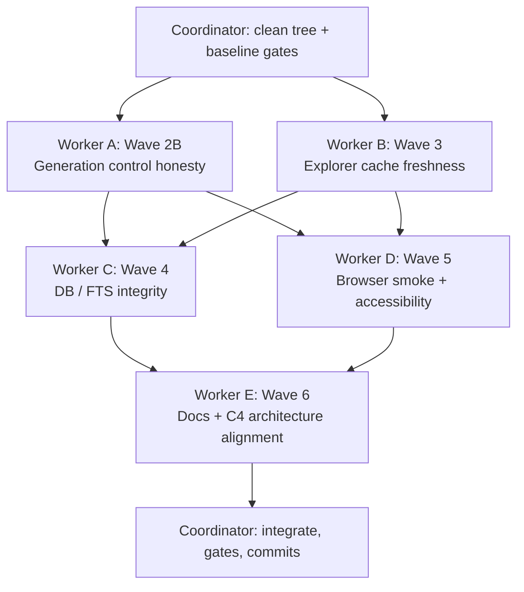
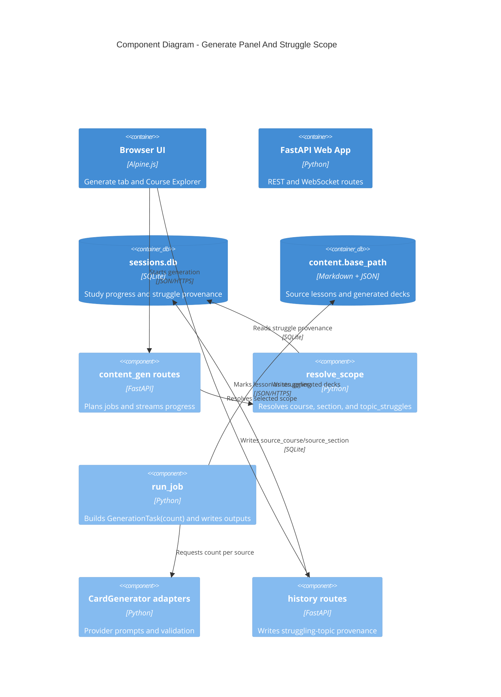

# StudyLoop Wave 2B To 6 Quality Implementation Plan

> **For agentic workers:** REQUIRED SUB-SKILL: Use superpowers:subagent-driven-development (recommended) or superpowers:executing-plans to implement this plan task-by-task. Steps use checkbox (`- [ ]`) syntax for tracking.

**Goal:** Complete the next quality waves by making generation controls honest, Course Explorer cache freshness reliable, database/search integrity executable, browser smoke coverage user-flow oriented, and documentation/C4 diagrams aligned with the shipped system.

**Architecture:** Keep implementation lanes independent where possible, then integrate through a coordinator. User-facing behavior changes must ship with focused tests, user/troubleshooting docs, and architecture/C4 updates in the same wave. Avoid broad route or frontend rewrites unless a failing test proves the current structure cannot satisfy the contract.

**Tech Stack:** Python 3.13, FastAPI, Click, SQLite/FTS5, pytest, pytest-playwright, Alpine.js, MkDocs Material, Mermaid C4/flow diagrams, uv, Just.

---

## Current Starting Point

The repository currently has Wave 1 and Wave 2A local commits on `main`:

```text
098506a fix(content): resolve struggles from lesson provenance
9719482 test(web): harden session start lifecycle
bd80495 fix(web): improve study feedback UX
0b6be9b fix(install): align agent contracts
14094d5 fix(content): harden source path handling
```

Before execution, the coordinator should confirm:

```bash
git status --short --branch
git log --oneline -5
```

Expected:

```text
## main...origin/main [ahead 5]
```

and the five commits above at the top of the log.

## Subagent Fanout Strategy

The active-agent limit in this environment is normally two workers. Run the lanes in rounds:



Recommended rounds:

1. **Round 1:** Worker A and Worker B in parallel.
2. **Round 2:** Worker C and Worker D in parallel.
3. **Round 3:** Worker E after implementation details are known.
4. **Coordinator:** final review, tests, docs build, commit split.

Workers must not commit. The coordinator creates commits.

## Commit Boundaries

Use small logical commits:

```text
fix(content): make generation counts explicit
fix(web): refresh explorer cache on nested content changes
test(db): cover fts and migration integrity
test(web): add learner workflow browser smoke
docs: align quality waves and architecture diagrams
```

If a worker only adds tests because production already satisfies the contract, use `test(...)` instead of `fix(...)`.

## Shared Verification

Each worker runs its focused tests. The coordinator runs:

```bash
just lint
just typecheck
just docs
just test
```

If browser smoke or layout tests are touched, also run:

```bash
uv run --group dev pytest -m e2e packages/studyloop/tests/test_web_smoke_browser.py -q
```

If C4 or Mermaid docs are touched, run:

```bash
just docs
rg "```mermaid|C4" docs/architecture docs/system-overview.md docs/web-ui-guide.md
```

---

## Worker A — Wave 2B: Generation Control Honesty

**Goal:** Ensure `count_per_source` is real and explainable from browser form through API, job planning, task execution, and generated output.

**Owns:**

- `packages/studyloop/src/studyloop/content/job.py`
- `packages/studyloop/src/studyloop/content/generators/runner.py`
- `packages/studyloop/src/studyloop/content/generators/stub.py`
- `packages/studyloop/src/studyloop/web/routes/content_gen/_jobs.py`
- `packages/studyloop/src/studyloop/web/static/index.html`
- `packages/studyloop/src/studyloop/web/static/components.js`
- `packages/studyloop/tests/test_content_job_runner.py`
- `packages/studyloop/tests/test_content_generators_stub.py`
- `packages/studyloop/tests/test_web_content_gen_rest.py`
- `packages/studyloop/tests/test_web_content_generation_service.py`

**Does not edit:** Explorer routes, DB migrations, architecture docs, troubleshooting docs.

### Task A1: Add End-To-End Count Contract Tests

- [ ] Add or extend a test proving `_build_job_request()` carries `count_per_source` into `JobRequest`.

Run:

```bash
uv run --group dev pytest packages/studyloop/tests/test_web_content_gen_rest.py::TestGenerateRest -q
```

Expected: the new test fails first if the request drops the count, then passes after implementation.

- [ ] Add a test proving `_build_tasks()` creates `GenerationTask.count == count_per_source` for both flashcards and quizzes.

Suggested assertion:

```python
assert {task.count for task in tasks} == {25}
assert {task.kind for task in tasks} == {"flashcards", "quizzes"}
```

- [ ] Add a stub-generator test proving a requested count wins over `stub_card_count`.

Suggested assertion:

```python
deck = StubGenerator(config_with_stub_count_3).generate_flashcards("source", "Title", count=5)
assert len(deck.cards) == 5
```

### Task A2: Make Provider Honesty Visible

- [ ] Inspect all `CardGenerator` implementations for count behavior:
  - `stub.py`
  - `ollama.py`
  - `openai_compat.py`
  - `anthropic_compat.py`
  - `bedrock.py`

- [ ] If all providers pass `count` into prompts, add tests around prompt construction rather than changing behavior.

- [ ] If a provider ignores `count`, fix it or add an explicit API/UI warning field.

Preferred response shape if warning is needed:

```json
{
  "plan": {
    "sources": [],
    "task_count": 2,
    "kinds": ["flashcards"],
    "backend": "stub",
    "warnings": ["Provider X treats count_per_source as a target, not a guarantee."]
  }
}
```

Only add this field if a real provider limitation exists; do not add warning plumbing speculatively.

### Task A3: Improve Generation Progress Text

- [ ] Update browser progress copy so a learner sees:
  - number of sources
  - selected deck kinds
  - requested count per source
  - provider/model when known

- [ ] Add a DOM or component-level test if an existing frontend test surface can assert this without brittle selectors.

### Task A4: Worker A Verification

Run:

```bash
uv run --group dev pytest \
  packages/studyloop/tests/test_content_job_runner.py \
  packages/studyloop/tests/test_content_generators_stub.py \
  packages/studyloop/tests/test_web_content_gen_rest.py \
  packages/studyloop/tests/test_web_content_generation_service.py \
  -q
uv run --group dev ruff check \
  packages/studyloop/src/studyloop/content/job.py \
  packages/studyloop/src/studyloop/content/generators \
  packages/studyloop/src/studyloop/web/routes/content_gen \
  packages/studyloop/tests/test_content_job_runner.py \
  packages/studyloop/tests/test_content_generators_stub.py \
  packages/studyloop/tests/test_web_content_gen_rest.py
```

Expected: all pass.

---

## Worker B — Wave 3: Course Explorer Cache Freshness

**Goal:** Ensure Course Explorer tree/list/search results refresh when nested lesson files are added, changed, or deleted.

**Owns:**

- `packages/studyloop/src/studyloop/web/routes/explorer.py`
- `packages/studyloop/tests/test_web_explorer.py`
- `packages/studyloop/tests/test_web_layout_regression.py` only if a visible UI defect is found

**Does not edit:** content generation jobs, history progress, DB migrations, docs.

### Task B1: Replace Base-Mtime Tree Cache With A Tree Fingerprint

Current risk: `/api/explorer/tree` caches only `content.base_path` mtime, so nested content changes can leave stale provider/course data.

- [ ] Add a helper in `explorer.py`:

```python
def _tree_fingerprint(base: Path) -> tuple[int, float]:
    """Return a cheap fingerprint for provider/course directories and lesson files."""
```

Recommended implementation:

- Walk provider/course directories and source files under `base`.
- Skip dot-dirs, `flashcards`, and `quizzes`.
- Return `(entry_count, newest_mtime)`.
- Use `os.stat()` and tolerate `OSError`.
- Keep symlink escape protections already present in lesson/content routes.

- [ ] Change `explorer_tree()` cache key from `explorer_tree_mtime` to `explorer_tree_fingerprint`.

### Task B2: Add Cache Regression Tests

- [ ] Add a test where the first `/api/explorer/tree` call sees one course, then a nested new course or lesson is added, then the second call returns fresh data.

- [ ] Add a test where deleting a nested course changes the tree result.

- [ ] Add a test proving output dirs still do not affect the tree:

```python
(course / "flashcards").mkdir()
(course / "flashcards" / "generated.md").write_text("# Generated", encoding="utf-8")
```

Expected: generated output does not create a visible course/lesson.

### Task B3: Keep FTS Refresh Behavior Covered

Existing FTS tests already cover mtime and delete behavior. Extend only if the tree-fingerprint change reveals a missing case.

Run:

```bash
uv run --group dev pytest packages/studyloop/tests/test_web_explorer.py -q
```

Expected: all pass.

---

## Worker C — Wave 4: Database And Search Integrity

**Goal:** Make SQLite/FTS migration edge cases executable so study history and search stay trustworthy across upgrades.

**Owns:**

- `packages/agent-session-tools/src/agent_session_tools/migrations.py`
- `packages/agent-session-tools/src/agent_session_tools/schema.sql`
- `packages/agent-session-tools/tests/test_migrations.py`
- `packages/agent-session-tools/tests/test_semantic_search.py` only if search behavior changes

**Does not edit:** web routes, frontend static files, install scripts.

### Task C1: Add FTS NULL Transition Tests

Migration 23 currently reinstalls `messages_fts_update` with NULL transition handling. Add tests for:

- `content NULL -> "new searchable text"` appears in FTS.
- `content "old searchable text" -> NULL` disappears from FTS.
- `role NULL -> "assistant"` updates FTS metadata without crashing.
- `session_id NULL -> "session-1"` updates FTS metadata without crashing.

Suggested test shape:

```python
def test_messages_fts_update_handles_content_null_to_value(fresh_db: sqlite3.Connection) -> None:
    fresh_db.execute(
        "INSERT INTO sessions(id, source, started_at) VALUES ('s1', 'test', datetime('now'))"
    )
    fresh_db.execute(
        "INSERT INTO messages(id, session_id, role, content, timestamp) VALUES (?, ?, ?, ?, datetime('now'))",
        ("m1", "s1", "user", None),
    )
    fresh_db.execute("UPDATE messages SET content = ? WHERE id = ?", ("late searchable text", "m1"))
    rows = fresh_db.execute(
        "SELECT content FROM messages_fts WHERE messages_fts MATCH 'late'"
    ).fetchall()
    assert rows
```

Adjust column names to match the existing schema in `test_migrations.py`; do not invent new schema.

### Task C2: Add Legacy Migration Smoke Fixture

- [ ] Create a minimal legacy DB fixture in test code or `packages/agent-session-tools/tests/fixtures/legacy_sessions_v0.sql`.
- [ ] Run all migrations against it.
- [ ] Assert:
  - `messages_fts` exists.
  - FTS search works after migration.
  - `study_progress` has provenance columns from migration 22.
  - `PRAGMA foreign_keys` remains enabled after migration helper returns.

### Task C3: Clarify Schema Ownership In Tests

Add comments in `test_migrations.py` explaining:

- `agent-session-tools` owns base session DB schema and migrations.
- `studyloop.history.progress` consumes `study_progress` and must tolerate pre-v22 DBs.
- `explorer_fts.db` is a derived cache and is not migrated.

This is test documentation, not a public docs replacement.

### Task C4: Worker C Verification

Run:

```bash
uv run --group dev pytest packages/agent-session-tools/tests/test_migrations.py -q
uv run --group dev pytest packages/agent-session-tools/tests/test_semantic_search.py -q
```

Expected: all pass.

---

## Worker D — Wave 5: Browser Smoke And Accessibility

**Goal:** Add a fast browser smoke suite that checks learner-critical flows and catches obvious accessibility/failure-state regressions.

**Owns:**

- `packages/studyloop/tests/test_web_smoke_browser.py`
- `packages/studyloop/tests/test_web_generate_topics_e2e.py`
- `packages/studyloop/tests/test_web_explorer_struggle.py`
- `packages/studyloop/src/studyloop/web/static/index.html` only for verified accessibility defects
- `packages/studyloop/src/studyloop/web/static/style.css` only for verified layout/accessibility defects
- `Justfile` only if adding a new `test-browser-smoke` recipe

**Does not edit:** generation backends, DB migrations, docs.

### Task D1: Add Learner Workflow Browser Smoke

Add a Playwright test that covers:

1. App loads.
2. Course Explorer opens.
3. A course/lesson can be selected from stubbed API responses.
4. Lesson reader displays markdown content.
5. `Struggling?` posts to `/api/history/struggling-topics`.
6. Generate panel can be opened and shows the struggled topic option or generation scope controls.

Use route stubbing for stability. Do not depend on the user's real vault.

### Task D2: Add Keyboard And Visible Failure-State Checks

Add checks for:

- Course Explorer can close with Escape.
- Main controls have accessible names.
- A failed struggling-topic POST shows an error and does not show success.
- Generate 409 busy response shows a visible busy/error state.

### Task D3: Add Optional Just Recipe

If no suitable recipe exists, add:

```just
test-browser-smoke:
    uv run --group dev pytest -m e2e packages/studyloop/tests/test_web_smoke_browser.py -q
```

If an equivalent recipe already exists, reuse it and do not add another.

### Task D4: Worker D Verification

Run:

```bash
uv run --group dev pytest -m e2e packages/studyloop/tests/test_web_smoke_browser.py -q
uv run --group dev pytest packages/studyloop/tests/test_web_explorer_struggle.py packages/studyloop/tests/test_web_generate_topics_e2e.py -q
```

Expected: all pass.

---

## Worker E — Wave 6: User, Troubleshooting, And Architecture Documentation

**Goal:** Align the docs with Waves 2B-5 and update any impacted Mermaid C4 diagrams.

**Owns:**

- `docs/web-ui-guide.md`
- `docs/content-pipeline.md`
- `docs/troubleshooting.md`
- `docs/system-overview.md`
- `docs/architecture.md`
- `docs/architecture/current.md`
- `docs/architecture/target.md`
- `docs/ownership.md`
- `docs/roadmap.md`
- `mkdocs.yml` only if a new public doc page is added

**Does not edit:** production code or tests unless a docs command exposes a broken doc link caused by this worker.

### Task E1: Update User Documentation

Update `docs/web-ui-guide.md`:

- Explain that `count_per_source` is a requested per-source target and, after Worker A, how the UI reports it.
- Explain Course Explorer cache freshness behavior after Worker B.
- Keep the existing Struggling provenance explanation.
- Add a short "What to do when generation seems stuck" note that points to troubleshooting.

Update `docs/content-pipeline.md`:

- Show the flow:

```text
source markdown -> resolve_scope -> GenerationTask(count) -> provider prompt -> flashcards/quizzes -> review surface
```

- Document provider count behavior accurately after Worker A.

### Task E2: Update Troubleshooting

Update `docs/troubleshooting.md` with concrete sections:

- **Generation is busy or stuck**
  - Check the Generate panel status.
  - Wait for the active job to finish.
  - Restart `studyloop web` if a local process was killed mid-job.
- **Generated too many or too few cards**
  - Explain count target vs provider validation.
  - Mention provider prompt adherence if relevant.
- **Course Explorer looks stale**
  - Refresh browser.
  - Confirm source file lives under `content.base_path`.
  - Delete derived `explorer_fts.db` only for search index issues.
- **Search results are stale**
  - Explain FTS cache is derived and rebuilt/refreshed.
- **Progress or struggles missing**
  - Run `studyloop self-test`.
  - Check `studyloop doctor --category database`.

### Task E3: Update Architecture And C4 Diagrams

Update `docs/architecture/current.md`:

- Generate panel component diagram must show:
  - `count_per_source`
  - `GenerationTask.count`
  - provider prompt generation
  - active generation singleton release owned by async background lifecycle
  - `topic_struggles` provenance lookup through `study_progress`

- Course Explorer component diagram must show:
  - tree cache key/fingerprint
  - FTS derived cache
  - `POST /api/history/struggling-topics`
  - provenance columns feeding generation scope

Use Mermaid C4 syntax where practical. If existing sections are flowcharts, either:

- convert the touched section to `C4Component`, or
- add a C4Component diagram immediately after the existing flowchart and keep the flowchart as the dynamic flow.

Minimum C4Component block for Generate:



Update `docs/system-overview.md` if the data-flow diagram still implies generic topic-only struggle generation.

Update `docs/architecture/target.md` only if implementation changes the target direction; otherwise add a note that Waves 2B-5 moved current architecture closer to the documented target.

### Task E4: Update Ownership And Roadmap

Update `docs/ownership.md` so owners are clear for:

- content generation scope/job/provider stack
- Course Explorer routes and cache
- session DB migrations and FTS
- browser smoke tests
- architecture diagrams

Update `docs/roadmap.md`:

- Mark completed items from Waves 1, 2A, 2B-5.
- Add remaining future work only if it is not implemented by these waves.

### Task E5: Worker E Verification

Run:

```bash
just docs
rg "count_per_source|GenerationTask|explorer_fts|source_section|C4Component" docs/architecture/current.md docs/web-ui-guide.md docs/content-pipeline.md docs/troubleshooting.md
```

Expected: docs build succeeds and each updated concept appears in the relevant docs.

---

## Coordinator Integration Checklist

- [ ] Start from clean tree.
- [ ] Dispatch Worker A and Worker B.
- [ ] Review Worker A/B diffs for scope leaks.
- [ ] Run Worker A/B focused tests.
- [ ] Dispatch Worker C and Worker D.
- [ ] Review Worker C/D diffs for scope leaks.
- [ ] Run Worker C/D focused tests.
- [ ] Dispatch Worker E with summaries of A-D shipped behavior.
- [ ] Run shared verification:

```bash
just lint
just typecheck
just docs
just test
```

- [ ] If browser tests changed:

```bash
uv run --group dev pytest -m e2e packages/studyloop/tests/test_web_smoke_browser.py -q
```

- [ ] Commit in logical boundaries.
- [ ] Report any residual warnings separately from failures.

## Acceptance Criteria

The wave is complete when:

- `count_per_source` has executable coverage from request planning through generator execution.
- Course Explorer cache detects nested source changes that affect visible provider/course/lesson state.
- FTS migration tests cover NULL transition edge cases and legacy DB compatibility.
- Browser smoke covers the learner path from course reading to struggle marking and generation panel visibility.
- User docs explain generation counts, stale explorer/search recovery, failed generation recovery, and progress/struggle troubleshooting.
- Architecture docs include updated Mermaid C4 coverage for Generate and Course Explorer data flows.
- `just lint`, `just typecheck`, `just docs`, and `just test` pass.
