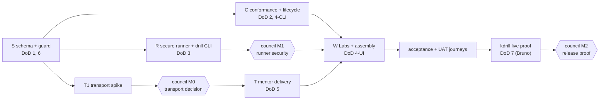

# Design — implementation and testing plan for module contract v1

**Status:** arbitrated plan, 2026-10-04 — not started. Source of the decisions:
`council/2026-10-04-plan-arbitration.md` (four planning seats; GPT-5.6's structure adopted,
calibrated against DeepSeek and Qwen; GLM discounted as off-brief). The contract being built is
`proposal.md` (commit `54d79e88`); this document says *how* and *in what order*, never *what*.
Every path below is repo-root-relative under `/Users/ataylor/code/personal/tools/studyloop`.

## 1. Shape in one paragraph

Five lanes, each a `feat/module-<lane>` branch in its own worktree with disjoint file
ownership and its own tests. The schema lane merges first and alone. Conformance, runner and
mentor-delivery lanes then run in parallel; the Web lane writes only its tests until all three
have merged, then implements. Every commit passes pre-commit and `just preflight`; every new
behaviour is shown failing before it passes, and that red run is kept as evidence. Three
council-of-models reviews sit where a wrong decision is expensive: the transport decision, the
runner's security boundary, and the release proof. Representative user testing runs on the
repository's existing acceptance and UAT tiers with Playwright. Bruno's kdrill conversion is
an external handoff whose acceptance test lives here. Budget 60–70 core agent-hours over
15–18 calendar days, limited by the owner's review bandwidth, not by agent compute.

## 2. Lanes and ownership

Worktrees are siblings of the main checkout (`../studyloop-wt-module-<lane>`), bootstrapped
with `env -u VIRTUAL_ENV just sync-dev` (a fresh worktree has no venv — `docs/contributing.md:61,74`).
Ownership is enforced by the re-keyed guard (§3); a lane editing a path owned only by another
lane fails its own gate.

| Lane | Branch | Owns (fnmatch, repo-relative) | Forbidden | DoD |
| --- | --- | --- | --- | --- |
| **S** schema + guard | `feat/module-schema` | `packages/studyloop/src/studyloop/content/schemas.py` · `packages/studyloop/tests/test_module_schema.py` · `packages/studyloop/tests/_lane_ownership.py` · `packages/studyloop/tests/test_lane_ownership.py` · `packages/studyloop/tests/fixtures/lane_ownership.yaml` · (docs commit only, §3) `docs/module-contract.md` · `.github/PULL_REQUEST_TEMPLATE/module.md` · `mkdocs.yml` · `CHANGELOG.md` | everything under `modules/`, `cli/`, `web/`, `session/` | 1, 6 |
| **C** conformance + lifecycle | `feat/module-conformance` | `packages/studyloop/src/studyloop/modules/{__init__,manifest,check,scaffold,store}.py` · `packages/studyloop/src/studyloop/cli/_module.py` · `packages/studyloop/src/studyloop/doctor/modules.py` · `packages/studyloop/src/studyloop/cli/_doctor.py` (one registration) · `packages/studyloop/tests/test_module_check.py` · `packages/studyloop/tests/test_module_lifecycle.py` · `packages/studyloop/tests/test_module_cli.py` · `packages/studyloop/tests/fixtures/modules/**` | runner, session, web, `cli/__init__.py` | 2, 4-CLI, §5.4 probes |
| **R** secure runner | `feat/module-runner` | `packages/studyloop/src/studyloop/modules/{runner,consent,attempt}.py` · `packages/studyloop/src/studyloop/cli/_drill.py` · `packages/studyloop/tests/test_module_runner.py` · `packages/studyloop/tests/test_module_drill_cli.py` · `packages/studyloop/tests/fixtures/runner/**` | schemas, transport, web, lifecycle store, `learning/practice.py` (untouched — the new path is separate) | 3 |
| **T** mentor delivery | `feat/module-mentor-delivery` | `packages/studyloop/src/studyloop/session/module_delivery.py` · `docs/adr/0012-practice-check-delivery.md` · `packages/studyloop/tests/test_module_delivery.py` · `packages/studyloop/tests/integration/test_module_delivery_transports.py` | `session/transports/*.py` and `session/transport.py` **until M0 proves a change is required**; all web | 5 |
| **W** Labs + assembly | `feat/module-web-labs` | `packages/studyloop/src/studyloop/web/routes/modules.py` · `packages/studyloop/src/studyloop/web/routes/session/_options.py` · `packages/studyloop/src/studyloop/web/static/{index.html,components.js,style.css}` · `packages/studyloop/src/studyloop/web/static/js/labs.js` · `packages/studyloop/src/studyloop/cli/__init__.py` (registrations) · `packages/studyloop/tests/test_web_modules.py` · `packages/studyloop/tests/js/module-labs.test.js` · `packages/studyloop/tests/e2e/test_module_labs_journey.py` · `packages/studyloop/tests/acceptance/test_module_kdrill_live.py` · `packages/studyloop/tests/acceptance/uat/**` (module rubric) · final docs/changelog reconciliation | schema, runner internals, delivery internals | 4-UI, 7 (acceptance test), assembly |

`web/app.py` router inclusion is a one-line edit owned by W. `packages/studyloop/tests/integration/`
does not exist yet; T creates it, marked `integration`.

## 3. Hotspots, the docs lease, and the ownership guard

- **`content/schemas.py`** — S only. C, R, W import; none edit.
- **`cli/__init__.py`** (command registration) — W only, at assembly. C and R expose their
  Typer groups as importable objects and register nothing; their CLI tests invoke the group
  objects directly with `CliRunner`.
- **`cli/_doctor.py`** — C only (one registration line for the module probes).
- **`web/routes/session/_options.py`**, the web trio, `labs.js` — W only.
- **`docs/`, `mkdocs.yml`, `CHANGELOG.md`** — a **docs lease**: one writer at a time. Another
  session is editing `docs/contributing.md`, `CONTRIBUTING.md`, `CHANGELOG.md` and `mkdocs.yml`
  in the main checkout as this is written; S's docs commit (S3) waits until that work has
  landed on `main`, then rebases once. W holds the lease last for reconciliation. Nobody in
  this change edits `docs/contributing.md`, `CONTRIBUTING.md` or `docs/contributor-modules.md`.
- **Lane-ownership guard** — S re-keys `tests/_lane_ownership.py` from the `lane/m<n>-` regex to
  an explicit branch→lane map (`feat/module-schema` → `S`, …) in `fixtures/lane_ownership.yaml`,
  preserving the legacy behaviour for the archived lanes, keeping fnmatch, `shared` and
  unmapped-is-logged semantics. The guard runs in every lane's gate, so a stray edit fails the
  commit, not the merge.

## 4. Merge DAG, waves and strategic commits

Merge order: **S → {C, R, T-spike}; T-spike → M0 → T; {C, R(after M1), T} → W; W → UAT →
kdrill proof → M2.** C and R merge independently unless R imports C's manifest types, in which
case C first. W is always last.

Agent waves (host cap: four concurrent):

| Wave | Agents | What they do |
| --- | --- | --- |
| 0 | S implementer · C red-test author · R adversarial red-test author · T spike investigator | S lands item 1. C and R write only failing tests and fixtures against the proposal. T reads the transport code and writes the ADR draft. |
| 1 (after S merges, M0 held) | C · R · T implementers · W test author | W writes `test_web_modules.py`, `module-labs.test.js` and the e2e journey against the proposal's API shape; implements nothing. |
| 2 (after C, R+M1, T merge) | W implementer (+ owner for UAT) | Labs, registrations, journey green, docs reconciliation. |
| 3 | owner + Bruno | `just testacc` / `just testuat` runs; kdrill live proof; M2. |

**Gate G, after every commit:** pre-commit (all hooks, including pyright at commit stage —
there is no pre-push stage in `.pre-commit-config.yaml`) **and** `env -u VIRTUAL_ENV just
preflight` (`lint typecheck test test-js docs release-consistency spec-check`). `just e2e`
takes a machine-wide lock (`docs/contributing.md:67`), so W runs it serially after its journey
commit. **Red-first rule:** a commit that adds behaviour carries, in its body or under
`openspec/changes/module-contract-v1/evidence/<lane>/`, the transcript of the new test
failing before the change. A test that was never red is not evidence.

Commit sequences (≤ 6 per lane, each passing G):

- **S:** S1 re-key guard + branch-parsing tests · S2 six schema fields, red→green, including
  rejection of missing/duplicate/invalid `id`s · S3 (after the docs lease is free) contract
  page, PR template, `mkdocs.yml` nav, first changelog entry.
- **C:** C1 fixtures — one valid scaffold tree plus `mc001` … `mc016`, each breaking exactly one
  rule, each with a repaired twin · C2 `check` engine + rule ids + `--json` · C3 `scaffold`/`new`
  · C4 atomic `add`/`list`/`remove`, snapshot digest, lockfile written only after `check`
  passes, git provenance read locally · C5 doctor probes `docker`/`kind`/`kubectl` with fake
  binaries · C6 CLI group tests.
- **R:** R1 adversarial tests red (shell token, symlink/hardlink, inherited env var, digest
  race, consent replay, timeout, output flood) · R2 argv-without-shell + regular-file +
  clean-environment boundary · R3 digest + argv + phase + target consent, re-checked at spawn ·
  R4 exit classes, per-phase timeouts, streamed caps, redaction · R5 transient `practice_check`
  recording with `test_drill_writes_no_observation` shown red against `learning/practice.py`
  first · R6 `studyloop drill <phase> <module>/<deck>/<task>`.
- **T:** T1 spike — ADR draft + test doubles only, no production code; **M0** · T2 typed,
  size-bounded `PracticeCheckEnvelope` + active-session adapter via `ActiveSession.transport`
  (`session/active.py:50-54`) · T3 PTY integration (`transports/pty.py:351-360` writes raw
  bytes; framing decided at M0) · T4 ACP integration (`transports/acp.py:267-290` fires a
  prompt turn; serialisation decided at M0) + learner-visible delivery failure.
- **W:** W1 `TestClient` hidden/visible/start API · W2 Labs HTML/JS/CSS · W3 CLI and router
  registrations · W4 Playwright journey (list, start, cancel, reload, keyboard) + serialised
  `just e2e` · W5 docs/changelog reconciliation + acceptance test for the kdrill proof.

## 5. Test strategy per DoD item

| DoD | Tests (lane) | Countable acceptance | Red-first evidence |
| --- | --- | --- | --- |
| 1 schema | `test_module_schema.py` (S) | the example deck validates; each of six fields round-trips; missing, duplicate and malformed `id` rejected; old deck still validates | the example deck fails against `schemas.py:270-305` before S2 |
| 2 `module check` | `test_module_check.py`, `test_module_cli.py`, `fixtures/modules/**` (C) | valid scaffold → exit 0 and `--json`; 16 single-fault fixtures each → non-zero naming exactly one `MCnnn`; 16 repaired twins pass | the 16 fixtures fail before C2 and the engine is shown refusing an "always fail" validator via the twins |
| 3 runner + `new` | `test_module_runner.py`, `test_module_drill_cli.py` (R); scaffold round-trip (C3 + R6) | subprocess spy asserts `shell=False`, argv shape, four-variable environment, consent binding, three exit classes, per-phase timeouts, byte truncation + redaction; **zero rows** added to observations | `test_drill_writes_no_observation` red against today's path (`practice.py:179-188`); `test_runner_never_shell` red against `practice.py:282-290` |
| 4-CLI `module add` | `test_module_lifecycle.py` (C) | failed check leaves `modules.lock.json` byte-identical; success writes digest (+ git provenance when present); `remove` idempotent | lockfile unchanged-on-failure test red before C4 |
| 4-UI Labs | `test_web_modules.py`, `js/module-labs.test.js`, `e2e/test_module_labs_journey.py` (W) | Labs absent with empty lockfile; present after install; start uses the existing session start inside the one claimed session; cancel; reload re-attaches without a second session | API tests red before W1; journey red before W2 |
| 5 mentor delivery | `test_module_delivery.py`, `integration/test_module_delivery_transports.py` (T) | one bounded, labelled envelope reaches a fake mentor on PTY and on ACP; identity + exit class present, output redacted; a third test proves delivery failure is learner-visible; ACP test proves no overlap with an in-flight learner turn | both transport tests red before T3/T4 |
| 6 docs | `test_docs_drift.py` extension (S3) | checklist present, four README headings, PR template, MC001–MC016 all linked | drift test red before S3 |
| 7 kdrill | `acceptance/test_module_kdrill_live.py` (W; run by owner), gated `STUDYLOOP_ACC=1 STUDYLOOP_LIVE=1` | converted snapshot passes `check`; setup/check/cleanup complete; the `studyloop-*` kind cluster disappears; a pre-existing sentinel cluster survives | n/a — live proof, recorded as evidence |

## 6. Representative user testing

Tiers are the existing ones (`docs/acceptance-testing.md`): **acceptance** = scripted actor
through the real surface (`just testacc …`, `STUDYLOOP_ACC=1`), **UAT** = browser journeys
graded against a written rubric for sign-off (`just testuat`, `STUDYLOOP_ACC=1 STUDYLOOP_UAT=1`,
files under `tests/acceptance/uat/`). Both use the `tests/e2e/_env.py` world (temp vault,
subprocess server, screenshot + HTML + console on failure); this plan adds server log, CLI
transcript, `modules.lock.json` diff and the attempt envelope to the failure bundle.

**Persona A — AuDHD learner on a tablet over `--lan`** (viewport 820×1180; acceptance budget
6 min, UAT 12 min). Steps and assertions: (1) load, assert no Labs entry and no prerequisite
text anywhere; (2) fixture runs `studyloop module add <scaffold>`, reload, assert exactly one
Labs entry; (3) open it, start one drill, assert it runs inside the single claimed session;
(4) assert focus lands in the terminal and Tab / Shift-Tab / Escape remain usable — the
keyboard-only traversal is part of this persona; (5) cancel, assert clear recovery copy;
(6) reload, assert re-attach with no second session; (7) install a fixture missing `kind`,
assert a concise prerequisite report and no resource creation; (8) `module remove`, reload,
assert Labs gone. Throughout: no overdue counter, no hint, solution or mentor notes in the DOM.

**Persona B — new contributor on a clean machine** (viewport 1440×900; acceptance 8 min, UAT
15 min): (1) documented `uv` setup; (2) `module new`; (3) `module check`; (4) the Persona-A
lifecycle; (5) break one fixture, read the JSON failure, repair it; (6) assert the docs'
commands and the observed output agree (`test_docs_drift.py` covers the static half).

**Human sign-off (UAT rubric):** both personas complete twice without a retry or a
facilitator explanation; every assertion green; no high-severity console or server error; the
learner can say where to start and where to stop without having seen an answer.

## 7. Council milestones

| Milestone | When | Inputs handed over | Questions it answers | Must NOT be used for |
| --- | --- | --- | --- | --- |
| **M0 transport decision** | after T1 | ADR draft; PTY and ACP traces; the serialisation options; failure semantics | PTY framing so injected text is unmistakably data; ACP: queue behind an in-flight turn or wait on `turn_end`; envelope size bound; what the learner sees on failure | writing implementation; reopening §5.7's contract |
| **M1 runner security boundary** | before R merges | R1 adversarial suite + results; argv/env/path/digest/consent code; redaction evidence | any way a module script escapes argv, reads the inherited environment, swaps a script after consent, replays a consent, or floods output | naming, UI, estimate |
| **M2 release proof** | after W + kdrill evidence | the seven DoD items' evidence; UAT artifacts; the scope exclusions | does each DoD item hold on evidence, not narrative; is anything v1.1/v2 leaking in | adding features |

Each council is four non-Claude seats from one fixed brief, arbitrated in the open, results
persisted under `council/`, exactly as the two 2026-10-04 rounds were run.

## 8. The transport spike (T1), scoped by what is already verified

Known: the live session exposes its transport (`ActiveSession.transport`,
`session/active.py:50-54`) with `send_input(bytes)` (`session/transport.py:145`). PTY writes
the bytes to the master fd (`transports/pty.py:351-360`) — the mentor sees them as if typed.
ACP decodes and fires `_prompt_turn` as a background task (`transports/acp.py:267-290`) — a
second prompt while the learner's turn is in flight is the hazard. T1 answers four questions
and nothing else: framing on PTY; serialisation on ACP; size bound; failure surfacing. Output:
`docs/adr/0012-practice-check-delivery.md` (draft) and test doubles. One day, then M0.

## 9. Risks, mitigations, detection gates

| Risk | Mitigation | Detection |
| --- | --- | --- |
| R2 runner security | adversarial tests first; M1 before merge | R1 suite: shell token, symlink, inherited secret, digest race, consent replay, flood |
| R1 delivery unknowns | T1 time-boxed to one day; M0 | both transport integration tests + ACP concurrency test |
| R4 vacuous tests | red-first rule; broken/repaired fixture pairs; evidence directory | missing red transcript fails review |
| R3 collisions | disjoint ownership; guard in every gate; docs lease; W last | guard failure on commit |
| R6 live proof external | freeze the accepted kdrill sha and interface by day 8; reserve owner Docker time | acceptance test preserves a sentinel cluster |
| R7 registry creep | C8; W5 review | grep for `index.json`/registry code in the change |

## 10. Effort, critical path, and the one-week cut

| Lane | Agent-hours |
| --- | --- |
| S | 8–10 |
| C | 12–14 |
| R | 16–18 |
| T | 9–11 |
| W | 12–14 |
| council corrections | ~6 |
| **Total core** | **60–70** (Bruno's conversion excluded) |

Calendar at two owner review-hours a day: days 1–3 S + T1/M0; days 4–9 C, R, T (M1 inside);
days 10–14 W; days 15–16 UAT and fixes; days 17–18 kdrill proof and M2 — **15–18 days**,
about 12 if the owner reviews four hours a day on weekends. The binding constraint is review
bandwidth: the owner reviews one lane's commit stack a day, not five interleaved diffs.

**One-week cut, if asked:** defer **W** (Labs) to v1.1 and call the result a *CLI contract
preview*; keep S, C, R, T and the kdrill proof. Never cut the kdrill proof — a standard no
real module has run against is not a standard.

## 11. What every lane brief contains

Settled constraints C1–C8 from `council/2026-10-04-plan-brief.md`; base sha; branch and
worktree path; bootstrap command; exact owned and forbidden globs; the DoD tests the lane must
make green and the red evidence it must preserve; gate G; dependencies and merge position; the
no-registry warning; stop and escalation conditions (a wall the lane cannot pass alone, a
hotspot it needs that it does not own, a contract gap it believes it found — report, do not
improvise). `include_memory=false`; the brief is the context.
