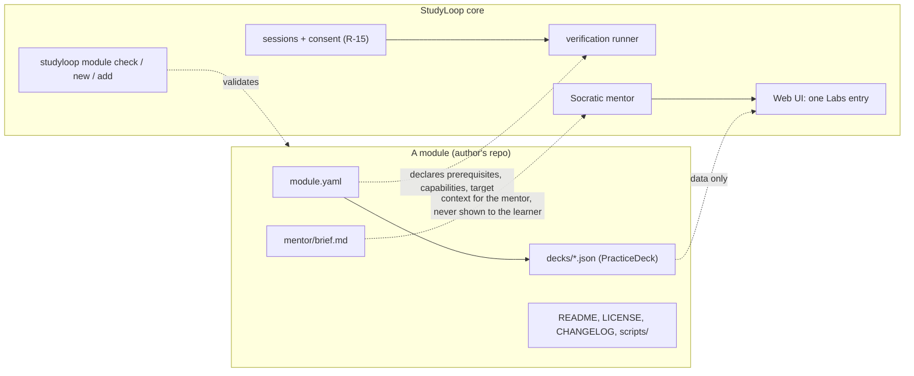

# StudyLoop Modules — contract v1 (MVP proposal)

**Status:** draft for discussion, 2026-10-04 — **revised the same day after a four-model council
review** (`council/2026-10-04-arbitration.md`; seats: OpenAI, Zhipu, DeepSeek, Alibaba). Nothing
in this document exists yet unless a line is marked **Exists**. Everything else is a proposal
to argue with.
**Motivated by:** [issue #53 — Kubernetes drills as a Web UI mode (kdrill)](https://github.com/NetDevAutomate/StudyLoop/issues/53).
**Readers:** the people who would build or use the first modules. Please answer the
questions in [§10](#10-questions-for-reviewers) — each has a recommended answer so you can
just say "yes" or "no, because".

## Summary

StudyLoop should let someone learn Kubernetes (or SQL, or Terraform) through hands-on drills
without StudyLoop becoming a Kubernetes application. The proposal is a small, strict **module
contract**: a module is a directory of *data* — a manifest, drills in StudyLoop's existing
practice-deck format, and a brief for the mentor — that StudyLoop core validates, lists under
one generic **Labs** entry in the Web UI, and runs through its own terminal, consent and
verification machinery. Modules declare; core executes. There is deliberately no field a
module can use to ask for special treatment, and nothing a module ships is ever imported by
core.

The model is the one Andy knows from the AWS Terraform Provider: a fixed interface, a
scaffold, a linter, offline-by-default tests with an opt-in live lane, mandatory docs — the
**contract discipline**. What we do *not* copy is the monorepo: modules live in their
authors' repositories, and a later catalogue is a reviewed index, not a loader or a hosted
registry. This revision folds in a four-model council review; the arbitration — what was
adopted, what was rejected and why — is in `council/2026-10-04-arbitration.md`.



## 1. Why a contract, and why now

- Issue #53 is the first request to bring a technology-specific practice tool into StudyLoop.
  It will not be the last. Without a contract each one becomes a bespoke integration
  ("snowflake") that only the core maintainer can review.
- The contract is what lets other people maintain modules **without** reviewing core, and lets
  core reviewers check a module in minutes: does `studyloop module check` pass, is the README
  honest, is the licence acceptable.
- A contract with one implementation is a guess. kdrill is the first implementation; the
  contract is not declared stable until a second, unrelated module (a SQL lab is the
  candidate) has been built against it. The council expects that lab to need a new target
  kind — i.e. **not** to fit unchanged — and finding that out is the point of stage 2. That is
  the rule of three applied to ourselves.

## 2. Principles

1. **Modules declare; core executes.** A module contains no Python, no entry points, no code
   that core imports. The only executable content is drill commands and the scripts they
   name, and those run only through core's runner, under consent and least privilege.
2. **One content format.** Drills use StudyLoop's existing `PracticeDeck` JSON. kdrill's YAML
   converts to it; the format does not bend to each tool (the SDK rule).
3. **Socratic by construction.** The learner sees a drill's `prompt` and `successCriteria`.
   `hint`, `solution` and the mentor brief reach the learner **only through the mentor**,
   which decides what to surface and asks before it tells. No "show solution" button exists
   outside that path.
4. **Absent means invisible.** A learner who has not installed a module never sees its
   prerequisites, its setup errors or its menu entry. The Labs entry is one generic item,
   hidden until a module is installed.
5. **Read-only is a capability, not a label.** A check's safety comes from the execution
   boundary core gives it — a disposable target, one executable run as argv without a shell,
   a clean environment, a consent bound to the script's digest — not from a YAML field or an
   LLM's opinion. A working directory on its own is not a sandbox.
6. **Checks are transient; mastery is not.** A passing check records that the task result was
   observed. Evidence of understanding still comes from teach-back and learning records,
   which modules cannot write.
7. **Offline by default.** `studyloop module check` and a module's default tests run without
   Docker, kind, cloud credentials or a paid model. Live drills are opt-in (`STUDYLOOP_LIVE=1`,
   the `TF_ACC=1` pattern).

## 3. The mapping, for people who know the Terraform provider

| AWS Terraform Provider | StudyLoop module contract v1 |
| --- | --- |
| Provider core: plan/apply, state, auth | Core: sessions, consent, mentor, learning records, Web UI |
| A resource implements a fixed Schema + CRUD | A module = `module.yaml` + `PracticeDeck` JSON + mentor brief; no code |
| `skaff` scaffolds a resource | `studyloop module new <id>` scaffolds a module with one passing offline drill |
| `tfproviderlint` / semgrep in `make lint` | `studyloop module check <path>` — the conformance suite; the same command runs in the module repo's CI |
| `TestAcc*` gated by `TF_ACC=1` | Live drills gated by `STUDYLOOP_LIVE=1`; default tests need nothing installed |
| `website/docs/r/*.md` is mandatory | `README.md` with required sections: prerequisites, what runs, data collected, limits |
| `required_providers` version constraint | `contract: 1` in the manifest; core refuses a module whose contract it does not speak |
| `.terraform.lock.hcl` checksums | `modules.lock.json`: content digest per installed module, plus git remote + sha as provenance when the source was a checkout (read locally; core never fetches) |
| Terraform Registry lists providers | (stage 3) `studyloop-module-index`: a reviewed `index.json`, CI runs `module check` on every entry — the krew-index model |

## 4. What exists today (the seams we reuse)

| Capability | Where | What it gives us |
| --- | --- | --- |
| **Exists** — `PracticeDeck` / `PracticeTask` / `PracticeVerification` | `packages/studyloop/src/studyloop/content/schemas.py` | Validated drills: `taskType`, `prompt`, `setup`, `successCriteria`, `hint`, `expectedLearningOutcome`; `verification.kind: checklist/rubric/command`, `command`, `setupCommand`, `expectedArtifacts`, `evidencePrompts`, `timeoutSeconds` (1–600) |
| **Exists** — `practice verify` with R-15 | `learning/practice.py`, `cli/_practice.py` | The exact command is shown and confirmed before it runs; the file is re-read and compared so a changed command cannot ride an earlier approval (R-15b). **Reused for its consent protocol only**: as built it executes only the `command` phase (`setupCommand` is surfaced, not run), runs the string with `shell=True` in the inherited environment, and records a `confident`/`struggling` observation into learner history — none of which the §5.5 runner or §5.7 evidence path may inherit |
| **Exists** — doctor checks | `doctor/*.py`, functions returning `list[CheckResult]` | Prerequisite reporting without side effects |
| **Exists** — web session + terminal, single session authority | `web/routes/session/`, ADR-0009 | One live session, origin-scoped console, cross-process claim file |
| **Exists** — mentor personas and shared protocols | `agents/shared/personas/`, `agents/shared/*.md` | The place a module's brief is composed into |

Everything in §5–§8 is new.

## 5. The contract

### 5.1 Module layout

```text
<module-repo>/
  module.yaml            # manifest (§5.2)
  decks/*.json           # one or more PracticeDeck files, each with a stable id (§5.3)
  mentor/brief.md        # what the mentor is told; never shown to the learner (§5.6)
  scripts/               # optional; one executable per drill phase, named by the drill; nothing else
  README.md              # required sections: Prerequisites, What runs, Data collected, Limits
  LICENSE
  CHANGELOG.md
  tests/                 # the module's own offline tests (the scaffold provides one)
```

### 5.2 Manifest — `module.yaml`

Validated by a Pydantic model with `extra: forbid`, like every content schema in core.

```yaml
id: kubernetes-drills            # slug; stable for the module's lifetime
contract: 1                      # StudyLoop module-contract version this module targets
version: 0.1.0                   # the module's own semver
title: Kubernetes hands-on drills (CKA/CKAD/CKS)
topic: kubernetes                # one tech area, as StudyLoop's backlog/topics use it
license: MIT
maintainers:
  - name: Bruno Lopes
    github: brunokktro
prerequisites:                   # ids from core's enum (§5.4); probes live in core, not here
  - { id: docker, min: "24" }
  - { id: kind,   min: "0.20" }
  - { id: kubectl }
capabilities: [terminal, setup, check, cleanup]   # the runner refuses anything undeclared
target:
  kind: kubeconfig-context       # v1 kinds: workdir | kubeconfig-context
  # For kubeconfig-context the attempt's target is a core-created disposable cluster named
  # studyloop-<module>-<drill>; the kubeconfig core injects holds exactly that one context.
  # Modules cannot pick the name and learner-owned contexts are never used.
```

### 5.3 Drills — the existing `PracticeDeck`, plus six fields

A kdrill drill (`setup` / `task` / `check` / `solution`, levels L0–L3) maps onto the existing
schema with six additive fields, marked ★ below. Two of them are identity: a deck and every
task carry a stable lowercase-hyphen `id`, and a drill's identity is
`(module id, module digest, deck id, task id)` — never an array position or a prompt string.

```json
{
  "id": "pods-and-namespaces",
  "title": "Pods and namespaces",
  "tasks": [
    {
      "id": "pods-01",
      "taskType": "apply",
      "prompt": "Create a namespace `drill` and run an nginx:1.27 pod named `web` in it.",
      "successCriteria": [
        "Namespace `drill` exists",
        "Pod `web` in `drill` is Running with image nginx:1.27"
      ],
      "expectedLearningOutcome": "Distinguish namespace scope from cluster scope when creating workloads.",
      "hint": "Which flag tells kubectl where to put the pod?",
      "solution": "kubectl create ns drill && kubectl run web --image=nginx:1.27 -n drill",
      "scaffolding": "guided",
      "mentorNotes": "Common slip: creating the pod in `default` and not noticing. Ask them where it landed before saying anything.",
      "verification": {
        "kind": "command",
        "successCriteria": ["Check script exits 0"],
        "setupCommand": "scripts/setup-pods-01.sh",
        "command": "scripts/check-pods-01.sh",
        "cleanupCommand": "scripts/cleanup-pods-01.sh",
        "timeoutSeconds": 30
      }
    }
  ]
}
```

| Field | Status | Notes |
| --- | --- | --- |
| `id` (deck) | ★ new on `PracticeDeck` | Stable slug; unique within the module |
| `id` (task) | ★ new on `PracticeTask` | Stable slug; unique within the deck; the source of `STUDYLOOP_DRILL_ID` |
| `solution` | ★ new on `PracticeTask` | Reaches the learner only via the mentor's "just show me" path, with the *why* explained after |
| `scaffolding` | ★ new on `PracticeTask` | `guided` / `hinted` / `unaided` / `exam` — kdrill's L0–L3, named for what the learner gets |
| `mentorNotes` | ★ new on `PracticeTask` | Per-drill addendum to `mentor/brief.md`; never rendered to the learner |
| `verification.cleanupCommand` | ★ new on `PracticeVerification` | Separate capability from `setup` and `check`; destructive, separately consented |
| `verification.timeoutSeconds` | **Exists**, meaning tightened | Applies to **each phase separately** (setup, check, cleanup); a timeout is an error, never a fail |
| everything else | **Exists** | unchanged |

Each phase command is one executable under `scripts/` plus literal arguments — no shell
syntax (§5.5, MC015).

Because the current schemas are `extra: forbid`, this example fails validation today and
validates only once the ★ fields land (DoD item 1 in §9, which ships first).

### 5.4 Prerequisites are an enum

`prerequisites[].id` must be one of a list core owns. v1: `docker`, `kind`, `kubectl` — only
tools an accepted v1 module actually exercises. (`duckdb` is deliberately **not** in v1: an
in-process library is a core-dependency question, not an external tool, and belongs to the
stage-2 SQL lab — see §10 Q10.) The probe for each id (how to find it, how to read its
version) lives in `doctor/`, returns `CheckResult`s like every other check, reports only for
modules the learner has installed, and **never creates resources or changes context**. A
module that needs a new tool opens a core PR adding the id and its probe — small, reviewable,
reusable by the next module.

### 5.5 The runner contract (core-owned)

This is the part that makes "modules declare; core executes" true at runtime. A working
directory is not a sandbox; the boundary is the whole execution model below, and every row is
a contract item, not an implementation detail.

| Aspect | v1 behaviour |
| --- | --- |
| Snapshot and identity | Core runs from the immutable module snapshot taken at `module add` (digest in `modules.lock.json`). Drill identity is `(module id, module digest, deck id, task id)`; `STUDYLOOP_DRILL_ID` is `<deck id>/<task id>` |
| Invocation | Each phase — `setup`, `check`, `cleanup` — is **one executable under `scripts/` plus literal arguments**, run as argv with `shell=False`. No shell, no operators, no substitutions, no interpreters (MC015). The referenced file must be a regular file inside the snapshot (MC013) |
| Environment | Built from scratch, never inherited: a scratch `HOME`/XDG under the attempt directory, a minimal `PATH`, and only `STUDYLOOP_MODULE_ID`, `STUDYLOOP_DRILL_ID`, `STUDYLOOP_ATTEMPT_ID` and `KUBECONFIG` (when applicable). Nothing from the learner's shell profile or the server's process environment reaches a drill |
| Working directory | A core-created, per-attempt directory; `target.kind: workdir` means nothing else is provided |
| Kubernetes identity | For `target.kind: kubeconfig-context`, the attempt's target is a **core-created disposable cluster**; core writes a kubeconfig containing exactly that one context and exports `KUBECONFIG`. Learner-owned contexts are never used. In v1 all three phases use the disposable cluster's credential — the disposable cluster *is* the blast-radius boundary |
| Context discipline | Commands must use the injected context. `--context`, `--kubeconfig` and `kubectl config use-context` fail `module check` (MC008) |
| Consent | **Per phase, per execution.** The exact argv **and the content digest of the referenced script** are shown and confirmed, and both are re-checked immediately before spawn — R-15b extended from the command text to the script's content. `setup` and `cleanup` each need a fresh consent every time they run. No standing grants in v1. On the web there is no `--yes` equivalent: consent is a one-use challenge issued *after* display, bound to digest + argv + phase + target + expiry (v1.1, §7) |
| Exit codes | `check`: `0` = passed · `1` = **failed (task not complete)** · `≥2` = could not run (cluster unreachable, script error). `setup`: any non-zero = error, attempt not started. `cleanup`: non-zero is logged and surfaced; the attempt still closes. A timeout is an error, never a fail |
| Timeouts | `timeoutSeconds` applies to each phase separately |
| Output | stdout+stderr **streamed** with byte and time caps (truncation recorded), redacted before persistence or delivery, kept for the attempt only; never written to learning records; delivered to the mentor as labelled data, never as instructions |
| Session | A drill runs **inside the one claimed study session** (ADR-0009). The runner is a subprocess of the server or CLI, not a second session |
| Cleanup | Deletes only the attempt's disposable cluster/resources; target teardown is a core operation, not module shell |

**Deferred to v2, together:** a **view-only check credential** (RBAC `view` ServiceAccount
bound into the injected kubeconfig) and the **attempt-scoped grant** that lets a check run
repeatedly without re-confirming (what kdrill's Auto Coach does today). They are one feature:
the credential exists to make the standing grant defensible, and on its own it protects only
one of three phases while leaving admin setup/cleanup and host execution untouched — so in v1
the disposable cluster is the boundary and per-phase consent is the control. The grant's
design (bound to module version + content digest, exact argv, target identity, expiry,
revocable, no side effects when denied) is written up in the optional-modules contributor page
(`docs/contributor-modules.md`, in preparation at the time of this draft) and is out of scope
for this MVP.

### 5.6 The mentor brief

`mentor/brief.md` is composed into the mentor's context when a drill is live: misconceptions,
Socratic question seeds, what not to reveal and when. It is the only channel by which a
module influences coaching, and it is advisory — the mentor's shared protocols (Socratic
engine, AuDHD framework, recording protocol) still govern. Everything a module contributes to
the mentor's context — the brief, `mentorNotes`, captured command output — is composed as
**labelled, untrusted data beneath those protocols**: it can inform the mentor, never instruct
it. Module authors write it the way they would brief a human teaching assistant.

### 5.7 Evidence and mentor delivery

When a check completes, core records a transient `practice_check` event on the attempt. It
does not create a learning record, a mastery claim or a review item. This needs a
**transient-only recording path**: the existing `practice verify` path cannot be reused for
it, because as built it records a `confident`/`struggling` observation into learner history
(`learning/practice.py`, verified by the council) — exactly what this section forbids.

**Mentor delivery is a contract item, not a detail.** Core delivers a typed, size-bounded
`practice_check` envelope (drill identity, phase, exit class, redacted truncated output) into
the claimed session's transport — PTY or ACP — labelled as data. Delivery failure is reported
to the learner, never silent, and an integration test proves both transports (DoD item 5).
The transport-level mechanism is settled in the design slice: at the time of this draft nobody
has verified a channel from a runner result to the mentor process, and the proposal will not
specify what has not been read.

The mentor, once told, may invite a teach-back; that is where evidence of understanding comes
from. Modules have no write path to learner history.

## 6. Conformance — `studyloop module check <path>`

Rule ids follow the provider-lint habit so a failure is quotable in a PR.

| Rule | Checks |
| --- | --- |
| MC001 | `module.yaml` validates (`extra: forbid`) |
| MC002 | `contract` is one this StudyLoop version speaks |
| MC003 | Required files present: `module.yaml`, ≥1 `decks/*.json`, `README.md`, `LICENSE`, `CHANGELOG.md` |
| MC004 | Every deck validates against `PracticeDeck` (with the §5.3 fields) |
| MC005 | Every `prerequisites[].id` is in core's enum |
| MC006 | Capability/field consistency: `setupCommand`⇄`setup`, `command`⇄`check`, `cleanupCommand`⇄`cleanup` |
| MC007 | No absolute or home-relative paths in commands; scripts are referenced relative to the module root and exist |
| MC008 | No context override in commands when `target.kind` is `kubeconfig-context` |
| MC009 | No secret patterns anywhere in the module (same detector family core already uses in pre-commit) |
| MC010 | Every task has `expectedLearningOutcome` and ≥1 `successCriteria`; a task with `solution` also has `scaffolding` |
| MC011 | `README.md` contains the four required headings |
| MC012 | No importable code: no `pyproject.toml`, `package.json`, `setup.py`, entry points or `*.py` in the module |
| MC013 | Every resolved deck and script path is a regular file inside the module snapshot — no symlinks, hardlinks, devices or path escape |
| MC014 | Deck and task `id`s present, slug-valid and unique within their scope |
| MC015 | Each phase command is one `scripts/...` executable plus literal arguments — no shell operators, substitutions or interpreters (the static half of `shell=False`) |
| MC016 | No capability declared in `module.yaml` that no deck uses |
| MC017 | A module whose `target.kind` is `kubeconfig-context` has `setupCommand` and `cleanupCommand` on every task — the disposable cluster is created by `setup` and deleted after `cleanup`, so a task missing either could never be run, or would leak a cluster (K0-review F6) |

The same command runs in the module repo's CI and, later, in the index repository's CI on
every entry.

## 7. CLI and Web UI surface (v1)

| Surface | Behaviour |
| --- | --- |
| `studyloop module new <id>` | Scaffolds §5.1 with one offline drill (`echo`-based check) that passes `module check` and runs end to end |
| `studyloop module check <path>` | §6; exit code non-zero on any failure; `--json` for CI |
| `studyloop module add <path>` | Copies the directory into StudyLoop's config dir as an immutable snapshot, runs `module check`, and **only on success** records the content digest in `modules.lock.json` — plus the git remote URL and `HEAD` sha as provenance when the path is a git checkout (read locally; core never fetches). Git-URL installation is stage 3 |
| `studyloop module list` / `remove <id>` | Lockfile-driven |
| `studyloop drill <setup\|check\|cleanup> <module>/<deck>/<task>` | Runs one phase through the §5.5 runner with per-phase consent and delivers the result per §5.7. **The MVP's only execution surface** |
| `studyloop doctor` | Reports each *installed* module's prerequisites via the enum probes; reports only, never installs or creates |
| Web UI **Labs** (MVP) | One generic entry, visible only when ≥1 module is installed; lists drills by module; starting a drill uses the existing session start + terminal inside the one claimed session. Checks are triggered from the CLI in the MVP |
| Web UI **Check progress** (v1.1) | A button that runs the consent → runner → result path from the browser. Deferred because it is a new security surface: it needs an HTTP consent endpoint with same-origin and CSRF protection, a one-use challenge (§5.5), active-session and attempt binding, and replay rejection — the existing origin check is consumed only by the WebSocket routes, not by HTTP POSTs |

In v1 there is **no automatic check after each command**: the learner triggers every check
explicitly. Installation stays in the CLI in v1, consistent with StudyLoop's existing split:
the Web UI is the study surface; configuration, doctor and install are CLI.

## 8. Explicitly out of scope for the MVP

- Hosting a registry, or any network fetch of an index at startup
- Installing modules from the Web UI, and `module add` from a git URL (stage 3)
- Browser-triggered check execution — the **Check progress** button (v1.1, §7)
- The view-only check credential and attempt-scoped grants / automatic per-command coaching
  (v2, together — §5.5)
- Modules that ship code core would import or execute as a library
- Authoring drills in the browser (StudyLoop's content generators may later target the
  module format; not now)
- A third `target.kind` beyond `workdir` and `kubeconfig-context` — the stage-2 SQL lab is
  expected to need one, and adding it then is the point

## 9. Definition of done, ownership, order

The MVP is done when all seven hold:

1. Manifest schema and the six §5.3 fields (`id` on deck and task, `solution`, `scaffolding`,
   `mentorNotes`, `cleanupCommand`) are in core with tests. **Ships first, on its own** — it
   is the only thing gating a module author's decks from validating.
2. `studyloop module check` passes on scaffold output and fails on a fixture set covering
   every rule MC001–MC017.
3. The §5.5 runner exists — argv without a shell, clean environment, digest-bound per-phase
   consent, streamed caps, per-phase timeouts, **transient-only recording** — and
   `studyloop module new` output runs end to end through `studyloop drill` with no Docker
   present. A test asserts that no learner observation is written.
4. `studyloop module add <path>` writes `modules.lock.json` only after `check` passes, and the
   Web UI lists the module's drills under Labs and starts one — one Playwright journey: list,
   start, cancel. (No browser check in the MVP.)
5. **Mentor delivery proven:** a `practice_check` envelope reaches the mentor on both the PTY
   and ACP transports — one integration test each.
6. `docs/module-contract.md` exists with an "Adding a module" checklist and a PR template.
7. **kdrill, converted to this layout, passes `module check`** and completes one live drill
   under `STUDYLOOP_LIVE=1` against a disposable kind cluster, deleting only what it created.

Item 7 is the acceptance test of the standard itself: if kdrill needs something the contract
lacks, either the need is generic (add it to v1) or kdrill adapts.

**Effort** (council-corrected; four seats put the original 45–60 at 42–85): as first
written, 55–70 agent-hours. This revised MVP, 40–50. v1.1 (browser Check progress: HTTP
consent endpoint, full browser journey), a further 15–20. Bruno's conversion and live proof
are his time and not counted.

| Slice | Proposed owner | Can start |
| --- | --- | --- |
| Schema fields (item 1) | Core — Andy | Now; ships alone within days |
| `module check` / `new` / `add`, lockfile (items 2, 4-CLI) | Core — Andy + a second core contributor | After item 1 |
| Runner + `studyloop drill` + transient recording (item 3) | Core — Andy; council-style security review before merge | After item 1 |
| Mentor delivery (item 5) | Core — whoever reads the transport code first | Design slice now; implementation after item 3 |
| Web Labs listing + start + journey (item 4-UI) | Second core contributor | **After items 3 and 5**, not after the schema alone |
| Contract doc + PR template (item 6) | Core | With item 1 |
| kdrill conversion + live proof (item 7) | Bruno | Drafts decks against §5.3 now; validates the day item 1 merges; live proof after item 3 |
| v1.1 browser Check progress | Second core contributor | After item 5 |
| Second module: SQL lab on in-process DuckDB (stage 2) | Someone who did **not** write the contract | After item 7; expected to need a `duckdb-database` target kind |

After stage 2 proves the boundary, stage 3 publishes the contract as stable and opens the
index repository; stage 4 (installation lifecycle, Web UI install, revocation) is designed
only then.

### Naming conventions

- **Module repositories:** `studyloop-module-<id>`, carrying the GitHub topic
  `studyloop-module`, where `<id>` is exactly the manifest's `id` — the
  `terraform-provider-<name>` convention. It is what makes discovery, a shared `module check`
  CI template and the later index mechanical. kdrill would become
  `studyloop-module-kubernetes-drills` (the project can keep its nickname).
- **Index repository (stage 3, not before):** `studyloop-module-index`, under the same
  organisation. It is an index of manifests pointing at sha-pinned artefacts with CI that runs
  `module check` on every entry — the `kubernetes-sigs/krew-index` model — not a hosted
  registry, so it is not called one. It is deliberately **not created** until the first module
  passes `module check`; an empty "registry" would advertise a capability that does not exist.
- **Casing:** lowercase-hyphen for everything except the core repository, matching the
  package and CLI name `studyloop`.

## 10. Questions for reviewers

Each has a recommended answer. "Yes" is a complete reply; so is "no, because …".

1. **Drill format.** Convert kdrill's YAML to `PracticeDeck` JSON rather than teaching core a
   second format? *Recommended: yes.* Bruno — what in kdrill's YAML does **not** map onto §5.3?
2. **Prerequisite enum for v1.** `docker`, `kind`, `kubectl`. *Recommended: exactly these
   three; `duckdb` waits for the stage-2 lab.* Anything missing for kdrill?
3. **Exit-code contract.** `check`: `0` passed / `1` failed (task not complete) / `≥2` could
   not run; `setup` non-zero is an error; `cleanup` non-zero is surfaced but not fatal.
   *Recommended: adopt.* Do kdrill's `check` scripts already fit, or do they need a thin wrapper?
4. **View-only checks → v2, together with the attempt-scoped grant.** In v1 the disposable
   cluster is the boundary and every phase is consented. *Recommended: yes, defer both.*
   Bruno — does any CKA/CKAD/CKS check genuinely need to read Secrets? That shapes v2's
   credential design, not v1.
5. **Scaffolding names.** `guided` / `hinted` / `unaided` / `exam` instead of L0–L3.
   *Recommended: words, with the L-mapping in the docs.*
6. **Topology.** Modules out of tree in their authors' repos; core owns contract + tooling;
   the later catalogue is an index. *Recommended: yes.* Objections?
7. **Labs visibility.** Hidden until a module is installed. *Recommended: yes.*
8. **Ownership and order** as in §9: item 1 ships first and alone; the Web slice waits for the
   runner and mentor delivery; browser checks are v1.1. *Recommended: as written.* Who takes
   the second core contributor slices? Bruno — draft decks now and validate the day item 1
   merges?
9. **Naming.** Module repos `studyloop-module-<id>` with topic `studyloop-module`; the stage-3
   index repo `studyloop-module-index`. *Recommended: yes.* Bruno — happy to rename when you
   start the conversion?
10. **Second module.** The council expects a DuckDB SQL lab to need a new `duckdb-database`
    target kind — i.e. **not** to fit v1 unchanged. *Recommended: accept that as the stage-2
    test rather than pre-adding the kind now.*
11. **Browser Check progress in v1.1, not the MVP.** *Recommended: yes* — the HTTP consent
    endpoint is a new security surface and deserves its own slice; the MVP proves the runner
    through the CLI first. The cost is that the one-button learner experience lands one
    release later.

Reply on issue #53, or as review comments on the pull request that carries this file.
