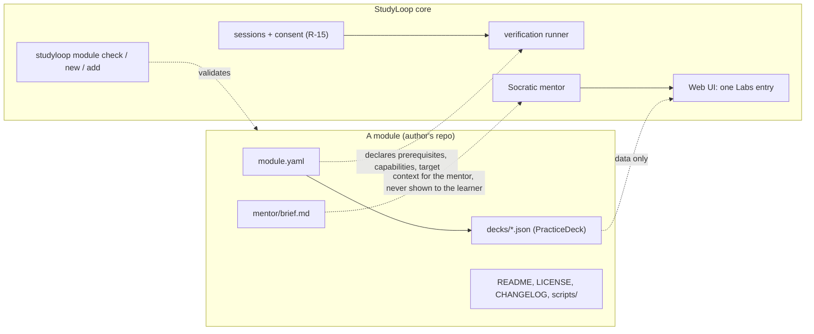

# StudyLoop Modules — contract v1 (MVP proposal)

**Status:** draft for discussion, 2026-10-04. Nothing in this document exists yet unless a
line is marked **Exists**. Everything else is a proposal to argue with.
**Motivated by:** [issue #53 — Kubernetes drills as a Web UI mode (kdrill)](https://github.com/NetDevAutomate/StudyLoop/issues/53).
**Readers:** the people who would build or use the first modules. Please answer the
questions in [§10](#10-questions-for-reviewers) — each has a recommended answer so you can
just say "yes" or "no, because".

## Summary

StudyLoop should let someone learn Kubernetes (or SQL, or Terraform) through hands-on drills
without StudyLoop becoming a Kubernetes application. The proposal is a small, strict **module
contract**: a module is a directory of *data* — a manifest, drills in StudyLoop's existing
practice-deck format, and a brief for the mentor — that StudyLoop core validates, lists under
one generic **Labs** entry in the Web UI, and runs through its own terminal, consent and
verification machinery. Modules declare; core executes. There is deliberately no field a
module can use to ask for special treatment, and nothing a module ships is ever imported by
core.

The model is the one Andy knows from the AWS Terraform Provider: a fixed interface, a
scaffold, a linter, offline-by-default tests with an opt-in live lane, mandatory docs — the
**contract discipline**. What we do *not* copy is the monorepo: modules live in their
authors' repositories, and a later registry is a reviewed index, not a loader.



## 1. Why a contract, and why now

- Issue #53 is the first request to bring a technology-specific practice tool into StudyLoop.
  It will not be the last. Without a contract each one becomes a bespoke integration
  ("snowflake") that only the core maintainer can review.
- The contract is what lets other people maintain modules **without** reviewing core, and lets
  core reviewers check a module in minutes: does `studyloop module check` pass, is the README
  honest, is the licence acceptable.
- A contract with one implementation is a guess. kdrill is the first implementation; the
  contract is not declared stable until a second, unrelated module (a SQL lab is the
  candidate) fits it without changes. That is the rule of three applied to ourselves.

## 2. Principles

1. **Modules declare; core executes.** A module contains no Python, no entry points, no code
   that core imports. The only executable content is drill commands and the scripts they
   name, and those run only through core's runner, under consent and least privilege.
2. **One content format.** Drills use StudyLoop's existing `PracticeDeck` JSON. kdrill's YAML
   converts to it; the format does not bend to each tool (the SDK rule).
3. **Socratic by construction.** The learner sees a drill's `prompt` and `successCriteria`.
   `hint`, `solution` and the mentor brief reach the learner **only through the mentor**,
   which decides what to surface and asks before it tells. No "show solution" button exists
   outside that path.
4. **Absent means invisible.** A learner who has not installed a module never sees its
   prerequisites, its setup errors or its menu entry. The Labs entry is one generic item,
   hidden until a module is installed.
5. **Read-only is a capability, not a label.** A check's safety comes from the credential and
   working directory core gives it, not from a YAML field or an LLM's opinion.
6. **Checks are transient; mastery is not.** A passing check records that the task result was
   observed. Evidence of understanding still comes from teach-back and learning records,
   which modules cannot write.
7. **Offline by default.** `studyloop module check` and a module's default tests run without
   Docker, kind, cloud credentials or a paid model. Live drills are opt-in (`STUDYLOOP_LIVE=1`,
   the `TF_ACC=1` pattern).

## 3. The mapping, for people who know the Terraform provider

| AWS Terraform Provider | StudyLoop module contract v1 |
| --- | --- |
| Provider core: plan/apply, state, auth | Core: sessions, consent, mentor, learning records, Web UI |
| A resource implements a fixed Schema + CRUD | A module = `module.yaml` + `PracticeDeck` JSON + mentor brief; no code |
| `skaff` scaffolds a resource | `studyloop module new <id>` scaffolds a module with one passing offline drill |
| `tfproviderlint` / semgrep in `make lint` | `studyloop module check <path>` — the conformance suite; the same command runs in the module repo's CI |
| `TestAcc*` gated by `TF_ACC=1` | Live drills gated by `STUDYLOOP_LIVE=1`; default tests need nothing installed |
| `website/docs/r/*.md` is mandatory | `README.md` with required sections: prerequisites, what runs, data collected, limits |
| `required_providers` version constraint | `contract: 1` in the manifest; core refuses a module whose contract it does not speak |
| `.terraform.lock.hcl` checksums | `modules.lock.json`: git sha + content digest per installed module |
| Terraform Registry lists providers | (stage 3) `studyloop-module-index`: a reviewed `index.json`, CI runs `module check` on every entry — the krew-index model |

## 4. What exists today (the seams we reuse)

| Capability | Where | What it gives us |
| --- | --- | --- |
| **Exists** — `PracticeDeck` / `PracticeTask` / `PracticeVerification` | `packages/studyloop/src/studyloop/content/schemas.py` | Validated drills: `taskType`, `prompt`, `setup`, `successCriteria`, `hint`, `expectedLearningOutcome`; `verification.kind: checklist/rubric/command`, `command`, `setupCommand`, `expectedArtifacts`, `evidencePrompts`, `timeoutSeconds` (1–600) |
| **Exists** — `practice verify` with R-15 | `learning/practice.py`, `cli/_practice.py` | The exact command is shown and confirmed before it runs; the file is re-read and compared so a changed command cannot ride an earlier approval (R-15b) |
| **Exists** — doctor checks | `doctor/*.py`, functions returning `list[CheckResult]` | Prerequisite reporting without side effects |
| **Exists** — web session + terminal, single session authority | `web/routes/session/`, ADR-0009 | One live session, origin-scoped console, cross-process claim file |
| **Exists** — mentor personas and shared protocols | `agents/shared/personas/`, `agents/shared/*.md` | The place a module's brief is composed into |

Everything in §5–§8 is new.

## 5. The contract

### 5.1 Module layout

```text
<module-repo>/
  module.yaml            # manifest (§5.2)
  decks/*.json           # one or more PracticeDeck files (§5.3)
  mentor/brief.md        # what the mentor is told; never shown to the learner (§5.5)
  scripts/               # optional; shell named by drill commands, nothing else
  README.md              # required sections: Prerequisites, What runs, Data collected, Limits
  LICENSE
  CHANGELOG.md
  tests/                 # the module's own offline tests (the scaffold provides one)
```

### 5.2 Manifest — `module.yaml`

Validated by a Pydantic model with `extra: forbid`, like every content schema in core.

```yaml
id: kubernetes-drills            # slug; stable for the module's lifetime
contract: 1                      # StudyLoop module-contract version this module targets
version: 0.1.0                   # the module's own semver
title: Kubernetes hands-on drills (CKA/CKAD/CKS)
topic: kubernetes                # one tech area, as StudyLoop's backlog/topics use it
license: MIT
maintainers:
  - name: Bruno Lopes
    github: brunokktro
prerequisites:                   # ids from core's enum (§5.4); probes live in core, not here
  - { id: docker, min: "24" }
  - { id: kind,   min: "0.20" }
  - { id: kubectl }
capabilities: [terminal, setup, check, cleanup]   # the runner refuses anything undeclared
target:
  kind: kubeconfig-context       # v1 kinds: workdir | kubeconfig-context
  # the context name is assigned by core: studyloop-<module>-<drill>; modules cannot pick it
```

### 5.3 Drills — the existing `PracticeDeck`, plus three fields

A kdrill drill (`setup` / `task` / `check` / `solution`, levels L0–L3) maps onto the existing
schema with three additive fields, marked ★ below.

```json
{
  "title": "Pods and namespaces",
  "tasks": [
    {
      "taskType": "apply",
      "prompt": "Create a namespace `drill` and run an nginx:1.27 pod named `web` in it.",
      "successCriteria": [
        "Namespace `drill` exists",
        "Pod `web` in `drill` is Running with image nginx:1.27"
      ],
      "expectedLearningOutcome": "Distinguish namespace scope from cluster scope when creating workloads.",
      "hint": "Which flag tells kubectl where to put the pod?",
      "solution": "kubectl create ns drill && kubectl run web --image=nginx:1.27 -n drill",
      "scaffolding": "guided",
      "mentorNotes": "Common slip: creating the pod in `default` and not noticing. Ask them where it landed before saying anything.",
      "verification": {
        "kind": "command",
        "successCriteria": ["Check script exits 0"],
        "setupCommand": "scripts/setup-pods-01.sh",
        "command": "scripts/check-pods-01.sh",
        "cleanupCommand": "scripts/cleanup-pods-01.sh",
        "timeoutSeconds": 30
      }
    }
  ]
}
```

| Field | Status | Notes |
| --- | --- | --- |
| `solution` | ★ new on `PracticeTask` | Reaches the learner only via the mentor's "just show me" path, with the *why* explained after |
| `scaffolding` | ★ new on `PracticeTask` | `guided` / `hinted` / `unaided` / `exam` — kdrill's L0–L3, named for what the learner gets |
| `mentorNotes` | ★ new on `PracticeTask` | Per-drill addendum to `mentor/brief.md`; never rendered to the learner |
| `verification.cleanupCommand` | ★ new on `PracticeVerification` | Separate capability from `setup` and `check`; destructive, separately consented |
| everything else | **Exists** | unchanged |

Because the current schemas are `extra: forbid`, this example fails validation today and
validates only once the ★ fields land (DoD item 1 in §9).

### 5.4 Prerequisites are an enum

`prerequisites[].id` must be one of a list core owns. v1 proposal: `docker`, `kind`, `kubectl`,
`duckdb` (for the SQL lab). The probe for each id (how to find it, how to read its version)
lives in `doctor/`, returns `CheckResult`s like every other check, and **never creates
resources or changes context**. A module that needs a new tool opens a core PR adding the id
and its probe — small, reviewable, reusable by the next module.

### 5.5 The runner contract (core-owned)

This is the part that makes "read-only" mean something.

| Aspect | v1 behaviour |
| --- | --- |
| Working directory | A core-created, per-attempt directory; `target.kind: workdir` means nothing else is provided |
| Kubernetes identity | For `target.kind: kubeconfig-context`, core writes a kubeconfig and exports `KUBECONFIG`. `check` runs with a **view-only** credential (RBAC `view` ClusterRole — which excludes Secrets); `setup`/`cleanup` run with the disposable cluster's admin credential, each separately consented |
| Context discipline | Commands must use the injected context. `--context`, `--kubeconfig` and `kubectl config use-context` fail `module check` |
| Consent | v1 keeps the existing per-command path: the exact resolved command is shown and confirmed, re-read and compared before execution (R-15/R-15b). No standing grants in v1 |
| Exit codes | `0` = pass · `1` = not yet · `≥2` = the check could not run (cluster unreachable, script error). Timeout is an error, never a fail |
| Output | stdout+stderr captured up to a fixed cap, redacted, kept for the attempt as transient evidence; never written to learning records |
| Environment | `STUDYLOOP_MODULE_ID`, `STUDYLOOP_DRILL_ID`, `STUDYLOOP_ATTEMPT_ID`, `KUBECONFIG` (when applicable); nothing from the learner's shell profile is implied |
| Cleanup | Deletes only the cluster/resources core assigned to the attempt; never the learner's current context |

**Deferred to v2:** an attempt-scoped grant that allows a check to run repeatedly without
re-confirming (what kdrill's Auto Coach does today). It becomes defensible only because the
check credential is view-only — the capability is enforced, not declared. Its design (bound to
module version + content digest, exact commands, target identity, expiry, revocable, no side
effects when denied) is written up in the optional-modules contributor page
(`docs/contributor-modules.md`, in preparation at the time of this draft) and is out of
scope for this MVP.

### 5.6 The mentor brief

`mentor/brief.md` is composed into the mentor's context when a drill is live: misconceptions,
Socratic question seeds, what not to reveal and when. It is the only channel by which a
module influences coaching, and it is advisory — the mentor's shared protocols (Socratic
engine, AuDHD framework, recording protocol) still govern. Module authors write it the way
they would brief a human teaching assistant.

### 5.7 Evidence

When a check passes, core records a transient `practice_check` event on the attempt. It does
not create a learning record, a mastery claim or a review item. The mentor is told the result
and may invite a teach-back; that is where evidence of understanding comes from. Modules have
no write path to learner history.

## 6. Conformance — `studyloop module check <path>`

Rule ids follow the provider-lint habit so a failure is quotable in a PR.

| Rule | Checks |
| --- | --- |
| MC001 | `module.yaml` validates (`extra: forbid`) |
| MC002 | `contract` is one this StudyLoop version speaks |
| MC003 | Required files present: `module.yaml`, ≥1 `decks/*.json`, `README.md`, `LICENSE`, `CHANGELOG.md` |
| MC004 | Every deck validates against `PracticeDeck` (with the §5.3 fields) |
| MC005 | Every `prerequisites[].id` is in core's enum |
| MC006 | Capability/field consistency: `setupCommand`⇄`setup`, `command`⇄`check`, `cleanupCommand`⇄`cleanup` |
| MC007 | No absolute or home-relative paths in commands; scripts are referenced relative to the module root and exist |
| MC008 | No context override in commands when `target.kind` is `kubeconfig-context` |
| MC009 | No secret patterns anywhere in the module (same detector family core already uses in pre-commit) |
| MC010 | Every task has `expectedLearningOutcome` and ≥1 `successCriteria`; a task with `solution` also has `scaffolding` |
| MC011 | `README.md` contains the four required headings |
| MC012 | No importable code: no `pyproject.toml`, `package.json`, `setup.py`, entry points or `*.py` in the module |

The same command runs in the module repo's CI and, later, in the registry's CI on every
index entry.

## 7. CLI and Web UI surface (v1)

| Surface | Behaviour |
| --- | --- |
| `studyloop module new <id>` | Scaffolds §5.1 with one offline drill (`echo`-based check) that passes `module check` and runs end to end |
| `studyloop module check <path>` | §6; exit code non-zero on any failure; `--json` for CI |
| `studyloop module add <path \| git-url@sha>` | Copies/clones into StudyLoop's config dir, runs `module check`, records sha + digest in `modules.lock.json`. Refuses an unpinned git ref |
| `studyloop module list` / `remove <id>` | Lockfile-driven |
| `studyloop doctor` | Reports each installed module's prerequisites via the enum probes; reports only, never installs or creates |
| Web UI **Labs** | One generic entry, visible only when ≥1 module is installed; lists drills by module; starting a drill uses the existing session start + terminal; an explicit **Check progress** button runs the consent → runner → result path and hands the result to the mentor |

Installation stays in the CLI in v1, consistent with StudyLoop's existing split: the Web UI is
the study surface; configuration, doctor and install are CLI.

## 8. Explicitly out of scope for the MVP

- Hosting a registry, or any network fetch of an index at startup
- Installing modules from the Web UI
- Attempt-scoped grants / automatic per-command coaching (v2, §5.5)
- Modules that ship code core would import or execute as a library
- Authoring drills in the browser (StudyLoop's content generators may later target the
  module format; not now)
- A second `target.kind` beyond `workdir` and `kubeconfig-context`

## 9. Definition of done, ownership, order

The MVP is done when all six hold:

1. Manifest schema and the three §5.3 fields are in core with tests.
2. `studyloop module check` passes on scaffold output and fails on a fixture set covering
   every rule MC001–MC012.
3. `studyloop module new` output runs end to end through the existing `practice verify`
   path with no Docker present.
4. `studyloop module add <local path>` writes `modules.lock.json`, and the Web UI lists its
   drills under Labs — one Playwright journey: start, check, fail, retry, pass, cancel.
5. `docs/module-contract.md` exists with an "Adding a module" checklist and a PR template.
6. **kdrill, converted to this layout, passes `module check`** and completes one live drill
   under `STUDYLOOP_LIVE=1` against a disposable kind cluster, deleting only what it created.

Item 6 is the acceptance test of the standard itself: if kdrill needs something the contract
lacks, either the need is generic (add it to v1) or kdrill adapts.

| Slice | Proposed owner | Can start |
| --- | --- | --- |
| Schema, runner contract, `module check` / `new` / `add`, lockfile (items 1–3) | Core — Andy + a second core contributor | Now |
| Web Labs entry + Playwright journey (item 4) | Second core contributor | After item 1 |
| Contract doc + PR template (item 5) | Core | With item 1 |
| kdrill conversion + live proof (item 6) | Bruno | Against the §5.3 draft now; `module check` once item 2 lands |
| Second module: SQL lab on in-process DuckDB (post-MVP, stage 2) | Someone who did **not** write the contract | After item 6 |

After stage 2 proves the boundary, stage 3 publishes the contract as stable and opens the
index repository; stage 4 (installation lifecycle, Web UI install, revocation) is designed
only then.

### Naming conventions

- **Module repositories:** `studyloop-module-<id>`, carrying the GitHub topic
  `studyloop-module`, where `<id>` is exactly the manifest's `id` — the
  `terraform-provider-<name>` convention. It is what makes discovery, a shared `module check`
  CI template and the later index mechanical. kdrill would become
  `studyloop-module-kubernetes-drills` (the project can keep its nickname).
- **Index repository (stage 3, not before):** `studyloop-module-index`, under the same
  organisation. It is an index of manifests pointing at sha-pinned artefacts with CI that runs
  `module check` on every entry — the `kubernetes-sigs/krew-index` model — not a hosted
  registry, so it is not called one. It is deliberately **not created** until the first module
  passes `module check`; an empty "registry" would advertise a capability that does not exist.
- **Casing:** lowercase-hyphen for everything except the core repository, matching the
  package and CLI name `studyloop`.

## 10. Questions for reviewers

Each has a recommended answer. "Yes" is a complete reply; so is "no, because …".

1. **Drill format.** Convert kdrill's YAML to `PracticeDeck` JSON rather than teaching core a
   second format? *Recommended: yes.* Bruno — what in kdrill's YAML does **not** map onto §5.3?
2. **Prerequisite enum for v1.** `docker`, `kind`, `kubectl`, `duckdb`. *Recommended: exactly
   these four.* Anything missing for the first two modules?
3. **Exit-code contract.** `0` pass / `1` not yet / `≥2` error. *Recommended: adopt.* Do kdrill's
   `check` scripts already fit, or do they need a thin wrapper?
4. **View-only checks.** A core-issued kubeconfig bound to the `view` ClusterRole for every
   `check`. *Recommended: yes.* Bruno — does any CKA/CKAD/CKS drill's check genuinely need to
   read Secrets or otherwise exceed `view`? If so, that drill is redesigned, not the credential.
5. **Scaffolding names.** `guided` / `hinted` / `unaided` / `exam` instead of L0–L3.
   *Recommended: words, with the L-mapping in the docs.*
6. **Topology.** Modules out of tree in their authors' repos; core owns contract + tooling;
   registry is an index. *Recommended: yes.* Objections?
7. **Labs visibility.** Hidden until a module is installed. *Recommended: yes.*
8. **Ownership and order** as in §9. *Recommended: as written.* Who takes the second core
   contributor slices, and does Bruno want to start the conversion against the draft schema
   before `module check` exists?
9. **Naming.** Module repos `studyloop-module-<id>` with topic `studyloop-module`; the stage-3
   index repo `studyloop-module-index`. *Recommended: yes.* Bruno — happy to rename when you
   start the conversion?

Reply on issue #53, or as review comments on the pull request that carries this file.
