## Context

Status: proposed implementation contract, 4 October 2026. Nothing below
is a claim of shipped registry behaviour. Start at [README.md](README.md).
See [proposal.md](proposal.md) for motivation and scope.

Source inspected: StudyLoop `75bab230d52e7e3dfb29992a2bbb911dbd330285`.

| Observed source | Constraint on this design |
| --- | --- |
| `../module-contract-v1/proposal.md` | Existing draft owns module layout, scaffolding, local add/remove, runner and Labs. Leave it intact; registry is a companion, not a replacement. |
| `packages/studyloop/src/studyloop/content/schemas.py` | Current PracticeDeck forbids unknown fields. The module draft's additional fields are not implemented. |
| `learning/practice.py`, `cli/_practice.py` in that package | Existing exact-command consent and reload/compare gate remain authoritative; setupCommand is metadata today. |
| `packages/studyloop/tests/e2e/_env.py` | Reuse isolated browser worlds for later consumer UI tests. |
| `docs/contributor-testing.md` | Reuse test layers, isolation, coverage gate and unique test basenames. |
| `mkdocs.yml` | Implementation specs are not learner-facing pages. Do not add this change to the public allowlist. |

All registry implementation paths below are **planned paths in a new
repository**, not files claimed to exist in StudyLoop today. The
`module-registry-resolution` capability is phase 2; phase 1 can finish
without claiming it is complete. Do not archive this entire change into
the shipped baseline until both normative capabilities are implemented.

## Goals / Non-Goals

**Goals:** a small reviewed catalogue; exact version identity; predictable
offline validation; trustworthy metadata publication; honest lifecycle
status; an interface the StudyLoop module runtime can consume later.

**Non-goals:** a marketplace, payments, ratings, telemetry, hosted learner
accounts, module execution service, arbitrary Python plugin loader,
browser module installer, automatic updates, background registry polling,
standing command grants, a new terminal stack or Kubernetes-specific
core navigation. No private repositories or module-to-module dependency
solver in v1. No registry writes to sessions.db, learner history or vaults.

## Decisions

### 1. Keep catalogue, content and execution separate

```mermaid
flowchart LR
  Author["Author repository: pinned module version"] --> PR["Registry metadata PR"]
  PR --> Check["Trusted validator: inspect data, never run drills"]
  Check --> Review["Maintainer review"]
  Review --> Index["Protected catalogue snapshot"]
  Index --> Resolve["Explicit refresh and exact-version resolution"]
  Resolve --> Install["Separate module installer: verify and consent"]
  Install --> Run["Core runner: separate execution consent"]
```

In words: an author proposes metadata, trusted tooling checks it, a
maintainer reviews it, and publication creates a snapshot. Later, the
learner explicitly resolves a version. Installation and execution remain
separate operations owned by the module runtime.

Choose a static GitHub repository rather than a hosted database/API:
PR history and protected branches are sufficient for the initial scale,
and core startup gains no service dependency. `StudyLoop-Modules` is a
provisional name, not permission to provision a GitHub repository.

Proposed registry layout:

- `schemas/`: versioned JSON Schema for publisher, release, lifecycle and
  catalogue records; strict unknown-field rejection.
- `publishers/<publisher>.json`: stable namespace and verified ownership.
- `entries/<publisher>/<module>/<version>.json`: immutable release data.
- `lifecycle/<publisher>/<module>/<version>.json`: mutable reviewed state
  and append-only transition history, separate from release identity.
- `catalogue.json`: generated, committed catalogue; never hand-edited.
- `src/studyloop_registry/`: trusted validation, build and resolution
  tooling with a small public interface and thin CLI adapter.
- `tests/fixtures/`: synthetic metadata and hostile archives; no learner
  data, cluster access or paid model required.
- governance, security policy, CODEOWNERS and submission templates.

Alternative rejected: core repository containing every module. It couples
unrelated authors' release schedules and grows the topic-agnostic core.

### 2. Version registry metadata independently of the module contract

Three versions are distinct: `registry_schema` (integer 1), module
`contract` (positive integer), and the author's module `version` (SemVer).
StudyLoop application compatibility is a separate Python version-specifier
string evaluated against the installed StudyLoop distribution version.
Use `packaging.specifiers` semantics, not a home-written range parser.
An application match does not imply a supported module contract.

The registry release record is JSON. It references `module.yaml`; it
does not replace that manifest, introduce another drill format, or
quietly implement new fields in PracticeDeck. The checker version and
the module contract must be pinned and validated together.

Required release fields and rules:

| Field | Normative meaning |
| --- | --- |
| `registry_schema` | Exactly 1 for this contract. Unknown major schemas are rejected. |
| `publisher`, `module_id` | Lowercase ASCII slugs, 1–64 characters, letters/digits with internal hyphens, no leading/trailing hyphen. Catalogue key is `publisher/module_id`. |
| `version` | Canonical SemVer, including optional prerelease; no build metadata in v1. `v1.0.0` is not a canonical version. |
| `title`, `summary`, `topics` | Plain text: title 1–120 Unicode characters, summary 1–500, at most 16 unique topics of 1–64 characters each. Reject control characters. Topic strings are descriptive metadata, not a core topic enum. |
| `contract`, `studyloop_requires` | Module contract integer and application version constraint. Both must match independently. |
| `source` | HTTPS GitHub repository URL, immutable repository numeric ID, full 40-hex commit SHA, safe relative module directory (or `.`). No branch, tag or shortened SHA. |
| `artifact` | HTTPS GitHub release asset URL and numeric asset ID; SHA-256 of exact downloaded bytes; declared byte size; format `tar.gz`. No userinfo, query credentials or arbitrary download host. |
| `content_digest` | `sha256-tree-v1` digest defined below, for equality with the declared source subtree and future installer handoff. |
| `license`, `documentation_path` | SPDX expression plus a LICENSE file; relative README/documentation path in the source subtree. Validate syntax and presence, not legal approval by automation. |
| `prerequisites`, `capabilities`, `target` | Exact normalized copies of contract-defined manifest values. No new registry-owned execution capability vocabulary. |
| `conformance` | Trusted checker release/commit, supported contract, result `pass`, input content digest, public evidence URL and validation time. It is evidence of conformance, not proof of harmlessness. |

Publisher records contain the namespace, display name, immutable GitHub
account/organization ID, authorized maintainers' GitHub IDs and source
repository IDs. A login rename does not silently transfer namespace
ownership. Namespace IDs are not recycled after removal. PR authorship
alone is not proof of ownership; maintainers verify GitHub identity and
repository control through authenticated GitHub metadata and review.

The existing module draft uses an unqualified manifest `id`; the registry
requires `module_id == manifest.id` and qualifies it with a publisher.
Phase 2 must preserve that coordinate in installation provenance. If the
then-current core cannot represent two publishers' identical module IDs,
reject the conflict explicitly; never overwrite one with the other.

### 3. Pin both the source and the delivered bytes

Release identity is `(publisher, module_id, version)`. Its entry is
append-only: source, artifact, checksum, compatibility, permissions and
conformance cannot be replaced in place. Corrections require a new module
version. Lifecycle status may change without changing that entry.

Trusted validation compares the safe archive's module contents with the
declared source subtree at the full SHA. Repository references and
release asset metadata must resolve to the recorded numeric IDs. A moved
tag, repackaged asset or transferred repository must not silently change
what an existing version resolves to.

`sha256-tree-v1` hashes a UTF-8 canonical JSON array of all regular files
in the selected module root. Each row has `[relative_posix_path, mode,
sha256_of_raw_file_bytes]`; `mode` is `0644` or `0755`, paths are sorted
by their UTF-8 bytes, JSON has no insignificant whitespace, non-ASCII
characters are emitted as UTF-8, and there is no trailing newline.
Empty directories are ignored; every file, including README and scripts,
is included. Paths must be Unicode NFC; reject normalization/case-fold
collisions for cross-platform safety. The checker publishes golden
vectors, including non-ASCII and executable files. No link following.

The artifact has exactly one top-level module directory containing the
manifest, without wrapper repositories. Source validation selects
`source.directory` for comparison. Reject symlinks, hardlinks, devices,
FIFOs, absolute/home-relative paths, traversal, NUL/backslash paths,
duplicate archive entries, unsupported modes, submodules and unresolved
Git LFS pointers. Never run git hooks, filters, package installers,
module tests, shell scripts or author-supplied workflows during review.

Initial hard limits: metadata record 64 KiB, catalogue 5 MiB, archive
25 MiB compressed / 100 MiB expanded, 2,000 files, 10 MiB per file,
240 UTF-8 bytes per relative path. Enforce streaming byte and entry
limits, not just declared sizes; abort a fetch after 30 seconds total.
Registry-wide changes to these limits require maintainer review.

Allow HTTPS GitHub APIs/content/release endpoints only, including the
documented release-asset redirect host in a centrally owned allowlist.
Revalidate every redirect, cap at three, forbid loopback/private/link-local
destinations and local protocols. Do not forward credentials across
origins. Public module metadata must never request credentials.

### 4. Run trusted checks on untrusted data

The registry owns an offline validator and deterministic builder. Its
public interface is: validate candidate against previous snapshot;
build catalogue from validated records; resolve exact version for a
consumer context. Typed diagnostics name a stable error code, record
coordinate and field, without dumping secret-looking values.

Suggested diagnostic families: schema, identity, immutable-release,
source-mismatch, unsafe-archive, integrity, compatibility, withdrawn,
revoked, stale-status and unavailable. The CLI returns 0 on success,
2 for invalid/ineligible input and 3 for retrieval/infrastructure failure;
JSON mode has `{ok, diagnostics, result}` with no mixed human text.
CLI names in the new repository are implementation details, not new
`studyloop` commands promised by this document.

Default checks are fully offline. Candidate metadata and hostile fixture
archives are data, not imported Python or JavaScript. The checker for
module conformance comes from a maintainer-pinned trusted version, never
from the submitted module repository. No `pip install`, `npm install`,
`make`, `just`, setup/check scripts or module tests from a submission.

Untrusted fork PR validation has read-only permissions, no secrets, no
self-hosted runner, no privileged caches and no deployment credentials.
Do not use `pull_request_target` to check out or execute PR-head content.
Validation logic must come from a pinned trusted base revision; changes
to that logic need a separate tooling PR, not a combined new-entry PR.
Artifacts from untrusted jobs are never promoted without independent
trusted validation. Pin third-party CI actions by full commit SHA.

Online source/archive verification is a separate bounded job using
trusted code and allowlisted fetches. It still never executes modules.
Protected-branch publication reruns validation against the actual merge
result to handle concurrent PRs, then checks deterministic catalogue
output. A PR's green badge alone is not a publication authorization.

### 5. Make catalogue snapshots auditable and reproducible

`catalogue.json` contains `registry_schema`, monotonically increasing
`sequence`, `published_at` (UTC RFC3339), publisher records and sorted
release records with lifecycle state. Sort coordinates lexically and
versions by SemVer precedence. Use UTF-8, LF, two-space JSON indentation
and one trailing newline. The sequence and publication time are explicit
release inputs; rebuilding the same inputs is byte-identical. A source
PR updates these inputs and generated output together, without embedding
the commit SHA of the file's own future commit.

The snapshot's authoritative revision is the Git commit containing it,
resolved externally by GitHub. The consumer fetches the protected branch
head explicitly, then reads all metadata at that exact commit. Store
that SHA plus the catalogue-byte checksum in the cache and handoff.
Never mix an index from one revision with lifecycle data from another.

Trust bootstrap is the approved registry repository URL plus immutable
repository ID, protected publication branch and authenticated TLS to
GitHub. A checksum inside an untrusted index is not a trust anchor.
V1 does not promise cryptographic protection from compromised GitHub
or registry maintainers; threshold-signed metadata is a later design.

Reject sequence rollback; reject equal sequence with different bytes.
Higher-sequence snapshots cannot erase known revoked identities or
delete version history. Emergency fixes produce a higher sequence,
never a force-pushed history rewrite. Preserve tombstones indefinitely.

### 6. Separate publication state from selection eligibility

| State | Meaning and selection behaviour |
| --- | --- |
| `candidate` | PR/fixture only; never present in the published catalogue. |
| `active` | Accepted release. May resolve if contract, application, prerelease and capability conditions match. |
| `deprecated` | Still selectable by exact version, with an explanation and optional replacement coordinate; never silently redirect. |
| `yanked` | Withdrawn from new resolution/install/update. Preserve metadata and installed provenance. |
| `revoked` | Known unsafe: refuse new resolution/install/update and refuse future launch once the local runtime learns this state. Preserve learning records; no automatic deletion or destructive cleanup. |

Transitions: candidate → active; active → deprecated/yanked/revoked;
deprecated → yanked/revoked; yanked → revoked. Revoked is terminal. A
withdrawn version is never reactivated; publish a new version instead.
History records from/to state, reason, time and public review/advisory
reference. Security reports begin through private advisory handling,
not a public issue containing exploit details or learner information.

One independent maintainer approves routine entries after successful
checks. Two independent maintainers approve namespace transfers, trust
configuration and workflow/schema changes; authors cannot self-approve.
An emergency revocation can be made by one designated responder, with
second-person review within two working days. That exception cannot
activate a release or expand capabilities. Record reviewers and policy
exceptions. Assign actual maintainers before publication; do not invent
an owner commitment or assign work to the issue author.

Abandonment does not transfer ownership automatically. Mark releases
deprecated with a reason; namespace transfer requires verified new
control and approval. Repositories changing numeric identity require
review and new source coordinates, not transparent redirection.

### 7. Give the later consumer a small, fail-closed interface

Phase 2 implements registry resolution behind one core-owned interface;
CLI, Web UI or MCP presentation must not duplicate its policy. Selection
input is exact coordinate/version plus the consumer's application
version, supported contract set and explicit prerelease opt-in. V1 has
no implicit `latest`, range-based install or fallback to another author.

Success returns an immutable resolution receipt: coordinate/version,
source repository ID/commit/directory, archive asset ID/URL/size/hash,
content digest, prerequisites/capabilities/target, compatibility,
lifecycle warning, registry repository ID/commit/sequence and fetched-at
time. Reading this receipt performs no download, install or execution.
The existing module installer is the only owner of installed inventory;
add provenance fields there rather than create a competing inventory.

Explicit refresh may fetch metadata. Ordinary startup, opening Today,
and running core study flows do not contact the registry. Cache records
use the configured StudyLoop state location with schema versioning,
atomic writes and last-good preservation. No learner database migration
is needed for phase 1. Phase 2 cache/provenance changes need their own
tested migration and corresponding owning-capability deltas.

A status fetch verified against the current protected branch head is
fresh for 24 hours, measured from successful fetch, not catalogue build
time. Failed fetches do not refresh that clock. This bounds normal
client staleness, not upstream publication delays. Fresh receipt required
for new installation, update and rollback; on stale/unavailable metadata,
allow cached browsing with explicit last-checked/unknown-current-status
labels, but refuse those mutations. Do not bypass via a generic force
flag. A local-path module workflow stays separate and must not display
registry endorsement when it bypasses this provenance path.

Already installed modules may continue offline under the runtime's
normal consent policy if no revocation is known; show stale status.
This means offline clients cannot know newly published revocations.
Once known, retain the denial even if the cache is later stale or an
older snapshot is presented. Revocation never kills a running terminal
or deletes learner data; deny the next launch and show explicit recovery
guidance. Repair/reinstallation requires an eligible new version.

The installer rechecks lifecycle, exact receipt and artifact bytes before
activation. Download to temporary storage, validate safely, then atomically
switch the installed reference. A failure leaves the old installation
intact. Updates display changed capabilities and require fresh consent;
registry approval carries no execution approval. Rollback is explicit,
uses a non-revoked eligible exact version, and never rewinds learner data.
Remove/disable/attempt cleanup remain the module runtime's responsibility.

### 8. Keep the runtime draft's unresolved claims out of registry guarantees

The existing module draft's regex command checks, environment variables
and Kubernetes view credentials are not a host sandbox. The registry
cannot enforce what a shell script does after launch. Conformance badges
must name checks performed, not say “safe”, “sandboxed” or “certified”.
Resolve runtime isolation claims in the module-contract workstream before
advertising them; do not weaken registry review to compensate.

The draft's additional PracticeTask fields, runner exit semantics,
local add/lockfile, Labs visibility and prerequisite enum belong to that
workstream. Registry IDs and version metadata are additive to it. A
checker is not ready until its claimed module schema actually exists.
Offline registry fixtures may use a clearly marked draft contract during
development; no real entry is published against an unimplemented checker.

## User stories and acceptance ownership

| ID | User story | Acceptance owner |
| --- | --- | --- |
| U01 | As a learner, I want to browse topics without installing tools, so that I can decide what is relevant. | Registry metadata + P2 discovery |
| U02 | As a learner, I want to see prerequisites, permissions and limitations, so that I can make an informed choice. | Schema + resolution receipt |
| U03 | As a learner, I want an exact compatible version, so that a similarly named module or new release cannot replace my choice. | Identity + compatibility |
| U04 | As a learner, I want installation separated from running commands, so that discovery cannot change my machine. | No-execution + installer seam |
| U05 | As a learner, I want unavailable and outdated information labelled, so that I do not mistake cached data for current safety advice. | Offline/freshness |
| U06 | As a learner, I want a failed download or update to preserve my existing installation, so that I can recover without losing work. | P2 atomic handoff |
| U07 | As a learner, I want known unsafe releases blocked without deleting my notes, so that I keep control of my work. | Revocation + runtime gate |
| U08 | As a module author, I want reproducible local checks and a submission template, so that my first contribution is reviewable. | P1 tooling + templates |
| U09 | As a module author, I want an actionable rejection reason, so that I can correct a submission without guessing. | Typed diagnostics |
| U10 | As a module author, I want new versions to preserve old identities, so that existing learners get predictable results. | Immutability |
| U11 | As a maintainer, I want verified namespace ownership, so that another author cannot take over a trusted name. | Publisher governance |
| U12 | As a maintainer, I want untrusted submissions checked without running them, so that review does not grant access to registry credentials. | CI isolation |
| U13 | As a maintainer, I want emergency withdrawal with an audit trail, so that risk can be reduced without erasing history. | Lifecycle |
| U14 | As a maintainer, I want reproducible protected publication, so that only the reviewed snapshot reaches learners. | Build/publication |
| U15 | As a module author, I want a documented ownership-transfer path, so that renaming or leaving the project does not strand users. | Governance |
| U16 | As a core contributor, I want one shared resolution interface, so that every presentation surface applies the same rules. | P2 seam |
| U17 | As a learner, I want core study flows to work without the registry, so that an outage or an unwanted module cannot interrupt studying. | Optionality |
| U18 | As a documentation contributor, I want verified release evidence and synthetic examples, so that the public guide describes what actually works. | P3 handoff |

## Risks / Trade-offs

- Maintainer/GitHub compromise → reviewed branch protection, pinned trusted
  tooling and auditable revisions; no claim of threshold-signed security.
- Revocation while offline → honest stale status and explicit mutation
  refusal; known revocations persist. No instantaneous global kill switch.
- Lint mistaken for a sandbox → no execution in registry, named badges,
  and separate runtime threat review.
- Premature universal extension API → freeze only after Kubernetes and
  an unrelated topic fit; no technology-specific registry code paths.
- Strict immutable metadata → corrections sometimes need a new version;
  predictable existing installs are worth that cost.
- External source/asset disappears → fail closed for retrieval, keep
  historical metadata; no unreviewed mirror substitution.

## Migration Plan

P1 has no StudyLoop runtime or database migration. Build locally in the
approved registry checkout, prove offline and hostile-input tests, then
configure GitHub protection and trusted publication after approval.
No website/runtime release is implied by a green registry test run.

P2 requires a versioned cache/provenance migration with old-state fixtures;
corrupt/unknown cache versions fail closed and preserve the old cache.
Core without modules must start unchanged. Roll back consumer software
without erasing the latest known revocations; metadata rollback is a new
sequence carrying retained tombstones, never an older trusted snapshot.

P3 receives the handoff checklist in README.md. Only then write public
installation/submission guides against the implemented commands and UI.

## Publication approvals

Before external provisioning/publication, the maintainer supplies the
GitHub owner/repository, responsible reviewers and security contact.
These are operational identities, not missing architectural decisions.
Before P2 activation, module-contract owners confirm the implemented
checker, provenance/qualified-ID support and installer seam. If those
contracts differ, amend this proposal openly rather than infer support.
